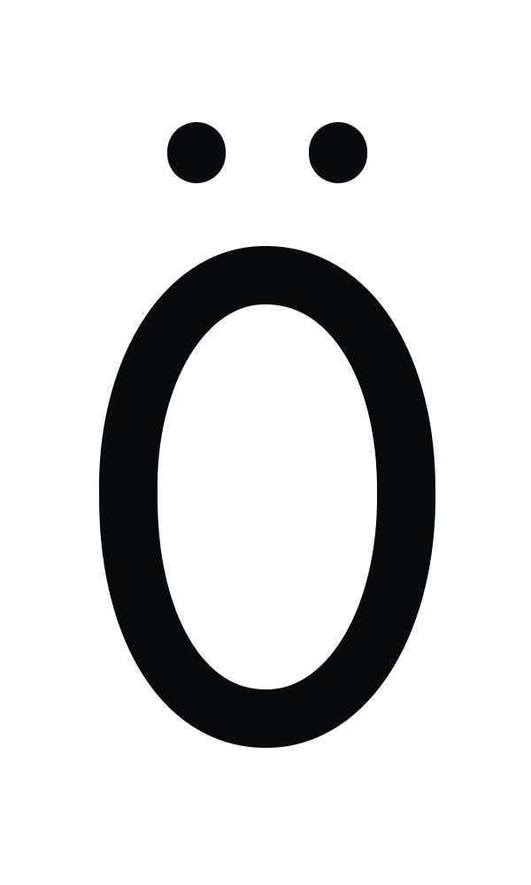
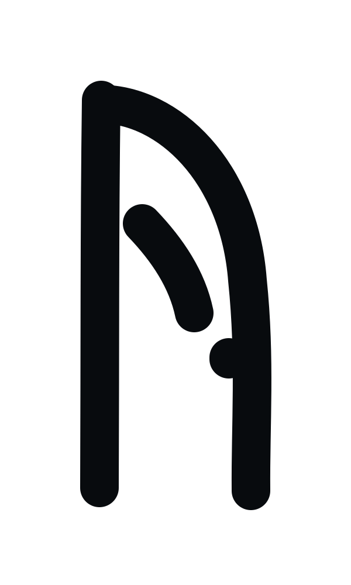
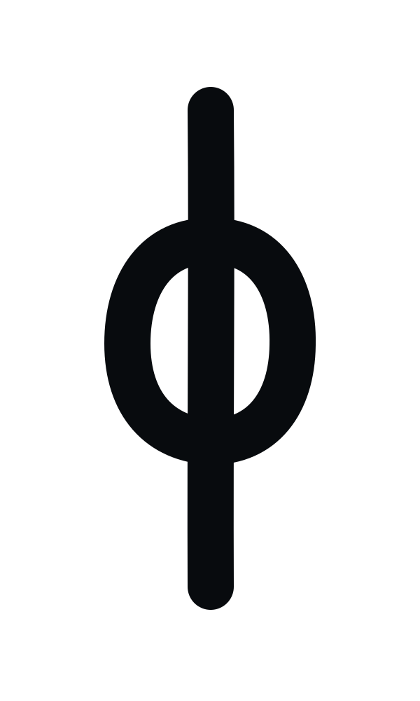
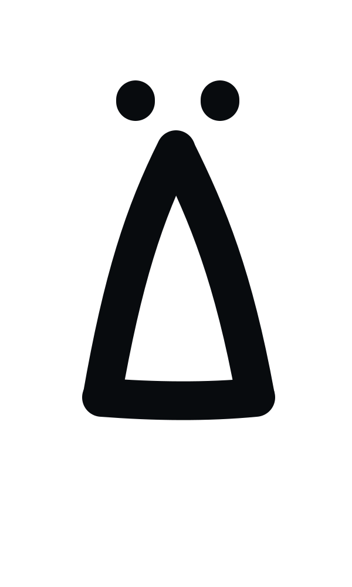
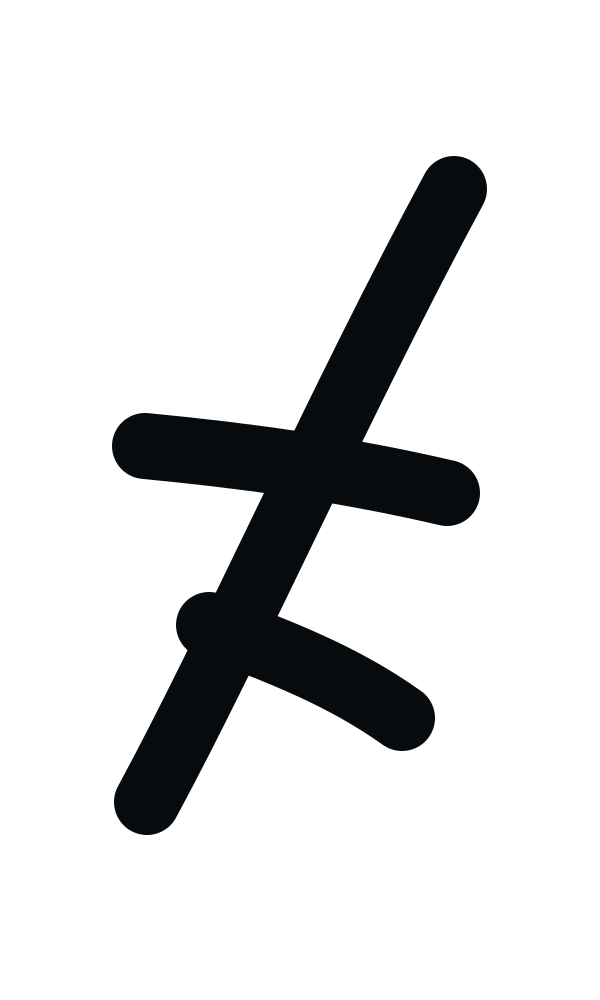
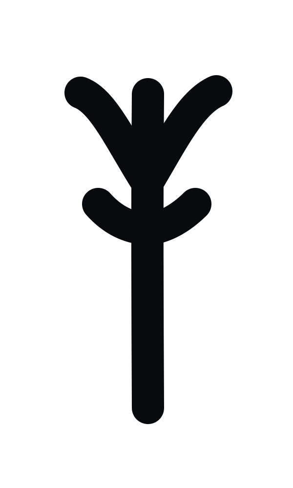

# Cuspell Dictionary and Writing Guide

_Status: current human-facing reference with all 217 approved core rune glyphs (2026-11-21)_

This is the working dictionary for Cuspell.

The **Rune** column now displays the approved glyph artwork directly as compact SVG images alongside the original G/R/A design IDs. The **Transliteration** column preserves the readable names used by the rules and parser; their meanings below are unchanged. [The canonical glyph mapping](../language/core/glyph_assignments.json) is the source of truth. The images reference original source artwork without changing the existing font's Unicode character assignments.

The dictionary lists **217 distinct one-mana registered core runes**, each with its approved glyph. Two historical sections repeat `Female` and `Worship` for context; those are not additional runes. The numeric-one sign `@` is an extra approved design and appears below the core entries. Typed measurement units are Old Names built from the single `Unit` root, so they do not add separate primitive rune entries.

## Dictionary

| Rune | Transliteration | Meaning |
| --- | --- | --- |
|  G051 | About | States that Information is about a semantic topic. |
|  R017 | Add | Adds compatible quantities. |
|  G039 | AfterValue | Value of a semantic value/attribute at the ending boundary of an event. Registered rune; written cost 1. |
|  A009 | All | Universal quantifier over a typed binder. |
|  A014 | Almost | Contextual near-satisfaction/near-occurrence operator: the target does not yet hold/occur but is close under a domain-specific criterion. |
|  G043 | And | Logical conjunction of propositions or executable conjunction of event specifications where licensed. |
|  R006 | AnswerFor | States that Information is an answer to QuestionContent. |
|  R052 | Area | Area quantity of a Region. |
|  R005 | Assert | Speech EventSpec asserting a proposition; assertion does not make content objectively true. |
|  R086 | At | Persistent spatial relation: an entity is at a Location; `End At source` + `Begin At goal` expresses discontinuous relocation without a Move Path. |
|  G102 | Attempt | EventSpec in which an agent undertakes a real effort aimed at a goal EventSpec; the goal need not succeed. |
|  R015 | Authority | Persistent recognized normative standing/competence over a supplied scope; distinct from physical Control, capability, and permission for a particular EventSpec. |
|  R104 | Ball | Constructs a spherical Region from center and radius. |
|  R001 | Before | Temporal order: first event/time point is earlier than the second. |
|  G035 | BeforeValue | Value of a semantic value/attribute at the beginning boundary of an event. Registered rune; written cost 1. |
|  R031 | Begin | Begins a persistent state; also returns the beginning TimePoint of an Event or TimeInterval. |
|  A041 | Believe | Persistent epistemic state: a mind believes a proposition. |
|  R078 | Beneficiary | Marks an entity as beneficiary of an Event/EventSpec; distinct from recipient, transfer, possession, or intended Purpose. |
|  R097 | Can | Persistent capability state for carrying out an EventSpec; `Begin Can ...` expresses skill acquisition. |
|  R047 | Cause | Causal relation between actual Events, or causative EventSpec where an entity causes an EventSpec/state; an optional third Entity records the instrument. |
|  A052 | Center | Returns the center Location of a Region. |
|  A030 | Change | EventSpec that sets an attribute/family value to a target. |
|  A073 | Rate | General per-time rate: Quantity-over-Time for a Quantity, or occurrence frequency for an EventSpec. |
|  A070 | Collect | Typed set comprehension: collects values from a binder's declared domain that satisfy an optional predicate; the collection preserves the binder type. |
|  A036 | Concurrent | Constructs an EventSpec whose component events occur concurrently. |
|  A058 | Confidence | Degree of confidence a mind assigns to a proposition. |
|  R076 | Contrast | Contextual discourse contrast/concession relation; unlike plain And, it also marks tension or expectation mismatch between the represented sides. |
|  G089 | Control | Persistent control/manipulability relation; concurrent `Begin Touch` + `Begin Control` expresses grabbing/taking hold. |
|  A028 | Create | Allocates exactly one previously unallocated Entity identity and binds it through an objective post-creation profile; an optional continuation can immediately use that fresh identity. Distinct from `Begin Exist`, which reactivates an already identifiable subject. |
|  G130 | Counterfactual | Contextual proposition: in a relevant contrary-to-actual alternative history where the antecedent holds, the consequent holds. |
|  G013 | Count | Returns the nonnegative integer count of members in a collection. |
|  A035 | Density | Scalar density attribute of an entity; returns a Density quantity. |
|  G122 | Directive | Constructs semantic CommandContent from an EventSpec without executing it. |
|  G086 | Distance | Physical/spatial separation between SpatialValues such as Entities, Locations, and Regions; returns Length. |
|  R038 | DistributionOf | Constructs a spatial Distribution of a resource over a host. |
|  G053 | Divide | Divides quantities and combines their dimensions. |
|  A060 | During | Temporal containment/holding of events, points, EventSpecs, or propositions over an explicit interval/reference. |
|  A029 | Each | Applies an EventSpec to each member of a collection. |
|  G025 | Edge | Returns edge Region(s) of an entity/Region. |
|  R083 | End | Ends a persistent state; returns the ending TimePoint of an Event or TimeInterval; or stops an ongoing Event when EventSpec is expected. |
|  A046 | Equal | States exact equality between two values of compatible type. |
|  R023 | Evaluate | Produces an ordered evaluation of a target. Two-argument form names the evaluator; one-argument form uses the discourse evaluator/context. |
|  G064 | EvidenceFor | States that Information is evidence supporting a proposition. |
|  G029 | Exist | Existence state over entities and semantic values such as Sign tokens; `Cause A Begin Exist S` expresses agentive creation of S. |
|  R028 | Expect | Relation: expect; roles mind, content; produces StateProposition. |
|  G060 | Explains | States that an Explanation explains a proposition; a contextual Proposition+Proposition frame covers ordinary discourse explanation (`target because reason`). |
|  G088 | Extent | General extent family: occupied Region, contextual holistic extent/size EvaluationValue, axis-indexed projected Length, or temporal extent of an Event/TimeInterval. |
|  A043 | Filter | Filters a collection by a typed binder/predicate. |
|  G024 | Find | Bounded factive information-acquisition Process: obtains the truthful yes/no or open-query answer for a mind through an explicit information-access scope. The scope must participate in the query; blocked/incomplete access is failure rather than a false/empty answer. |
|  R024 | First | Selects the first member of an ordered Sequence; with an EventSpec it contextually denotes the next/first matching occurrence. |
|  A026 | Form | Geometric/form profile of an entity. |
|  A037 | Gas | Matter-phase value/property: gas. |
|  G016 | Group | Kind: a group entity. |
|  A055 | Gustation | Sense channel: taste/gustation. |
|  G129 | Happen | States that an EventSpec actually occurs, optionally in an interval. |
|  A001 | High | Contextual above-standard predicate over ordered EvaluationValue, Quantity, or Ratio values; with an AttributeDescriptor it forms a first-class threshold Property. |
|  A007 | Low | Contextual below-standard predicate; with an AttributeDescriptor it forms a first-class threshold Property such as LowHunger. It is not equivalent to Not High. |
|  G062 | Have | Persistent possession/holding relation. |
|  R058 | Hearing | Sense channel: hearing. |
|  A051 | Heat | Scalar heat attribute of an entity. |
|  R088 | Here | Current contextual location. |
|  G036 | If | Conditional: if the condition holds, the consequent proposition/event follows in the represented structure. |
|  A008 | In | Persistent spatial relation: an entity is in a Region. |
|  R060 | Infer | EventSpec in which a mind infers a proposition from Information. |
|  G084 | Intend | States an agent's intention to carry out an EventSpec. |
|  R071 | Interval | Constructs a TimeInterval from start and end TimePoints. |
|  R112 | IntervalFor | Constructs a TimeInterval from a start TimePoint and duration. |
|  G070 | Joined | Persistent structural relation: two entities are joined. |
|  A039 | Know | Persistent epistemic state: a mind knows a proposition. |
|  G046 | Last | Selects the last member of an ordered Sequence. |
|  R098 | Length | Length attribute of an entity/path. |
|  A024 | Life | State property: alive/living. |
|  A015 | Light | Scalar light attribute of an entity. |
|  R095 | Like | States that an experiencer likes a target. |
|  A032 | Liquid | Matter-phase value/property: liquid. |
|  G007 | Magic | Persistent magical-state Property for Entities; typed EventSpec/Event frames classify magical-execution provenance for interception and audit. |
|  A061 | Mass | Scalar mass attribute of an entity. |
|  R111 | MaxBy | Tie-preserving maximum selector over a collection using a bound ordered key expression. |
|  A004 | Matter | Kind: matter/material substance. |
|  G049 | Meaning | Relates a Sign to its semantic Information/propositional meaning. |
|  R069 | Member | States that an entity is a member of a collection. |
|  R041 | MinBy | Tie-preserving minimum selector over a collection using a bound ordered key expression. |
|  R033 | More | States that the first ordered value is greater than the second. |
|  A075 | Most | Contextual majority/most quantifier over a typed binder. |
|  G001 | Move | EventSpec for moving an entity; magical execution must constrain goal or path. |
|  R012 | Multiply | Multiplies quantities and combines their dimensions. |
|  A027 | Name | Context-sensitive naming Relation between a Sign and a semantic referent; inverse lookup uses typed `Collect` + `Unique`, not a special Name frame. |
|  R089 | Not | Logical negation of a proposition. |
|  G075 | Now | Current contextual time point. |
|  R042 | Obligated | Persistent deontic/social responsibility for an EventSpec; an optional third value identifies its social/institutional/interpersonal context. |
|  R054 | Offset | Constructs a Location by moving a distance from an origin in a Direction. |
|  G116 | Olfaction | Sense channel: smell/olfaction. |
|  A012 | Opposite | Numeric opposite/negation of a quantity; also participates in licensed reversible lexical compounds. |
|  A031 | Or | Logical disjunction of propositions. |
|  G066 | Overlap | General typed overlap relation; Region/Region overlap means nontrivial shared interior extent and composes strict outside. |
|  G015 | Part | States that one entity is a part of another. |
|  R037 | Partition | Contextually partitions a collection into fixed-size subcollections. |
|  R040 | Permitted | Permission relation: agent+EventSpec states performer permission; EventSpec+Entity states that the event itself is permitted/consented to by that source. Particular permission/consent does not itself assert broad Authority. |
|  A018 | Persist | Actively maintains a state through an interval. |
|  A011 | Phase | Matter phase attribute of an entity. |
|  R026 | Plan | States that an agent has an EventSpec as a plan. |
|  A010 | Plasma | Matter-phase value/property: plasma. |
|  R101 | Power | Raises a quantity to a dimensionless exponent; dimensionful bases require a statically known valid exponent. |
|  A074 | Pressure | Absolute scalar mechanical-pressure Attribute; `Pressure Entity` queries a registered entity/material/system pressure and `Pressure Location` queries local ambient pressure. Its Quantity dimension is derived from Mass/Length/Time rather than being a new base dimension. |
|  A065 | Preserve | Constrains a selected value to remain equal across an event boundary. |
|  G041 | Prevent | Prevents a specified future EventSpec over an interval; bound EventSpec form intercepts any attempted candidate satisfying a predicate, optionally within a Region, before commit. |
|  R034 | Purpose | Persistent intended goal/function relation for a semantic subject, including artifact designed function; temporary Use does not establish it. |
|  G148 | Question | Constructs semantic QuestionContent from a proposition or typed open-question binder. |
|  A047 | Random | Selects one member from a collection. |
|  R102 | Ratio | Constructs a ratio from dimensionless numeric components; distinct from numeric division. |
|  G149 | Repeat | Repeats an EventSpec a specified number of times, optionally with a period. |
|  A033 | Represent | Objective persistent channel-specific representation relation: a carrier Entity presents/depicts semantic content through a named SenseChannel. Distinct from Meaning, Sense, and the carrier's own physical properties. |
|  R046 | Requires | States that an outcome/event has a prerequisite proposition. |
|  G006 | Root | Takes a quantity root; dimensionful inputs require a statically known degree that leaves integral dimension exponents. |
|  G105 | Rotate | Rigidly rotates an Entity about an explicit pivot + oriented axis by a signed number of full turns; distinct from translational Move and intrinsic Form change. |
|  R011 | Say | Speech EventSpec carrying a proposition, Information, or quoted Sign. |
|  A025 | Self | Current discourse self/speaker/caster reference. |
|  A042 | Sense | Generic sensory-acquisition EventSpec with an explicit SenseChannel; Sense does not itself entail semantic interpretation. |
|  A057 | Sequence | Constructs an ordered Sequence value, or an EventSpec that executes event specifications in order. |
|  A059 | ShapeLike | States that an entity's form resembles a Kind/template without asserting Kind identity. |
|  R014 | Sides | Returns side Region(s) of an entity, optionally relative to a frame. |
|  A066 | Simultaneous | States that two events/time points are simultaneous. |
|  A005 | Solid | Matter-phase value/property: solid. |
|  A034 | Some | Existential quantifier over a typed binder. |
|  R050 | SufficientFor | States that a condition is sufficient for an outcome/event. |
|  G037 | Surface | Returns the surface Region of an entity. |
|  G096 | That | Contextual previously/situationally salient entity reference. |
|  G093 | ThatEvent | Contextual other/salient event reference. |
|  R009 | There | Contextual non-here location. |
|  R074 | They | Contextual plural/entity-collection reference. |
|  R094 | Thing | General thing/entity Kind. |
|  G068 | This | Current salient singular entity reference. |
|  G021 | ThisEvent | Current salient event reference. |
|  A020 | ThisExplanation | Current salient Explanation value. |
|  R004 | ThisInformation | Current salient Information value. |
|  R043 | ThisInterval | Current salient time interval. |
|  R036 | ThisMethod | Current salient Method value. |
|  R057 | ThisPath | Current salient path. |
|  A072 | ThisRegion | Current salient region. |
|  R008 | Through | States that a Path passes through a Region, or constrains an event to occur through a Region. |
|  A038 | TimeFlow | Persistent relative local temporal progression for an Entity or Region. Takes an explicit spatial/worldline reference and nonnegative dimensionless rate factor; Zero stops local progression and @ matches the reference rate. |
|  R073 | TotalAmount | Returns total quantity represented by a Distribution, optionally within a Region. |
|  G058 | Touch | Persistent contact-state relation between two entities. |
|  R025 | TouchChannel | Sense channel: tactile touch. |
|  R067 | Toward | Constructs a Direction toward a reference. |
|  R068 | Transfer | EventSpec moving a resource/value from source to destination, optionally with an amount; Distribution transfers may add an optional destination profile after amount. |
|  G146 | Trigger | Creates an EventSpec that fires an action when a condition becomes true within a lifetime/scope. |
|  G003 | True | Boolean/propositional truth literal. |
|  R081 | Tube | Constructs a tubular Region around a Path with a radius. |
|  R035 | UnavailableValueOf | States that a particular attribute value exists but is unavailable/inaccessible. |
|  G038 | Unique | Reduces a collection only when it has exactly one member. |
|  R061 | Unit | General measurement-unit Kind/root. Specific typed units are historical Old Names such as `«LengthUnit»` and `«DurationUnit»`. |
|  A067 | UnknownValueOf | States that a particular attribute value is unknown. |
|  G103 | Use | EventSpec in which an agent uses an instrument to pursue a goal EventSpec. |
|  A050 | Vision | Sense channel: vision. |
|  A019 | Volume | Scalar volume attribute of an entity. |
|  G081 | Want | States that a mind desires an event or proposition. |
|  G022 | When | Schedules/locates an EventSpec at a time point or interval. |
|  A003 | Whole | Persistent structural integrity/completeness state; `End Whole X` expresses loss of wholeness. |
|  A053 | Worship | Ordinary intentional/religious worship Process. Worship does not itself entail that the object is objectively divine. |
|  R056 | You | Current addressee reference. |
|  A017 | Zero | Exact dimensionless numeric zero. |

### Foundational roots added in the first civilization vocabulary pass

These are productive semantic/descriptive roots, not English object nouns. Common objects such as Ship, House, Sword, Book, and Market are registered as descriptive Old Names instead; see `docs/world/FIRST_CIVILIZATION_VOCABULARY.md`.

| Rune | Transliteration | Meaning |
| --- | --- | --- |
|  R021 | Hard | Contextual material/structural hardness Property. |
|  G009 | Sharp | Contextual edge/point sharpness Property. |
|  G012 | Sleep | Persistent contextual sleep-state Property. |
|  G119 | Sign | General Sign Kind used by the information/language system. |
|  G121 | Rule | General rule/instruction Kind. |
|  A068 | Region | General spatial Region Kind. |
|  G032 | Path | General ordered route/path Kind. |

### Ordinary roots added by the audited Yona vocabulary pass

These are productive ordinary-language roots exposed repeatedly by Chapters 1–14 + 47. `Body` has since been migrated to the Old Name `«LifeMatter»`; Yona-specific proper/System terms remain New Names in the optional `world/yona` package.

| Rune | Transliteration | Meaning |
| --- | --- | --- |
|  G018 | Awake | Persistent wakefulness state Property. |
|  R007 | Open | Contextual persistent open-state Property relative to an object's closure/design. |
|  A021 | Locked | Persistent locked/sealed-by-lock state Property. |
|  G019 | Eat | Process: an agent consumes an entity as food. |
|  R084 | Attack | Process: an agent attacks a target. |
|  R019 | Bite | Process: an agent bites a target; oral biting manner is not identical to generic Attack, Eat, Touch, or Damage. |
|  G107 | Climb | Process: an agent climbs a target/entity; climbing manner is not merely upward Move and can include down/across/over traversal. |
|  G109 | Fall | Process: an entity undergoes non-agentive, context/gravity-governed falling motion. |
|  A062 | Female | Positive biological-sex classification Property; not defined as Not Male. Exact membership belongs to world ontology. |
|  A064 | Male | Positive biological-sex classification Property; not defined as Not Female. Exact membership belongs to world ontology. |
|  G113 | Jump | Contextual launch/airborne locomotion Process; a goal Location may be supplied. Generic Move does not encode the jumping manner. |
|  R100 | Stab | Directed puncturing/thrust Process against a target, optionally with an instrument; not equivalent to generic Attack, Damage, Touch, or Use. |
|  G117 | Limp | Locomotion Process with an asymmetric/impaired gait; does not by itself assert a particular Damage level or cause. |

### Residual ordinary roots from the Chapters 1–14 + 47 cleanup

These close the remaining ordinary combat, injury, graded-body-state, texture/camouflage, reflexive-action, and sound/intensity buckets identified by the audited corpus. `Sound` has since been migrated to the Old Name `«HearingThing»`.

| Rune | Transliteration | Meaning |
| --- | --- | --- |
|  G028 | Damage | Ordered physical-damage/injury degree Attribute. |
|  A016 | Health | Ordered overall biological functional-condition Attribute; distinct from Damage and Ill. |
|  G044 | Hunger | Ordered hunger-degree Attribute. |
|  G056 | Pain | Ordered experienced pain/nociceptive-suffering Attribute; distinct from physical Damage. |
|  A002 | Ill | Persistent pathological/illness-state Property; distinct from Damage, Pain, Low Health, and Not Life. |
|  G069 | TextureOf | TextureProfile Attribute of an Entity. |
|  G074 | Loudness | Ordered sound-loudness Attribute; objective measurement belongs to the world package. |
|  R103 | Dodge | Contextual evasive Process intended to avoid a threat; it need not prevent the threatening event itself. |
|  G097 | Reflexive | States that an EventSpec occurs as an involuntary/reflex response; absence of conscious intention alone is not equivalent. |
|  G100 | CamouflagedAgainst | Contextual observer/background-sensitive camouflage state; concrete ColorOf/TextureOf values alone do not define the full relation. |

Concrete anatomy nouns remain Old Names/world concepts rather than primitive roots. The current common layer includes body, hand, eye, ear, mouth, skin, bone, flesh, blood, organ, stomach, wrist, tendon, wound, head, face, arm, leg, foot, finger, nose, tooth, tongue, heart, brain, and hair.

Natural geography/weather vocabulary follows the same rule. Land, soil, sand, river, lake, sea/ocean, mountain, hill, island, shore/coast, forest, sky, cloud, rain, ice, snow, wind, and storm are world concepts + Old Names, not productive semantic roots. Exact geography/meteorology belongs to world classifiers and execution physics.

Food/agriculture/material vocabulary also stays primarily in the world/Old-Name layer. Field, seed, leaf, fruit, crop/cultivated plant, grain, milk, egg, salt, clay, cloth/textile, leather/hide, glass, and fuel are world concepts + Old Names. `Staple food` remains culture-relative world/history vocabulary rather than one universal core Kind; specific crop species, recipes, oils, spices, beverages, and similar material/food distinctions are likewise world-package concerns unless later pressure proves otherwise.

Craft/manufacturing/transport vocabulary likewise uses world concepts + Old Names for knife, axe, saw, pot, needle, wheel, cart/wagon, plow, loom, furnace/kiln, anvil, sail, oar, anchor, port, building, roof, room, floor, workshop, mill, and fortification. This batch adds one productive spatial Process, `Rotate`, because actual rigid turning cannot be expressed exactly by the existing translation/Form machinery.

War/public-institution vocabulary uses world concepts + Old Names for soldier, army, armor, shield, spear, bow, arrow, prison, prisoner, judge, polity/state, government, and citizen/member of polity. This batch adds the productive social Relation `Authority`. Checkpoint 118 re-audits that addition and retains it because recognized standing over a scope is not determined by particular permissions, obligations, capability, control, rules, or causation.

Art/ritual/shared-culture vocabulary uses world concepts + Old Names for temple, shrine, priest, ritual/ceremony, prayer, sacrifice/offering, dance, performance, game/sport, festival/feast, story/tale, music/composition, song, musical instrument, image/painting, and sculpture. Registered world Kind concepts support `classifies_types`: omission means Entity, while the sixteen current non-default categories explicitly classify EventSpec/Event, Information, or TimeInterval. Checkpoint 122 re-audits this mechanism, removes redundant explicit Entity metadata, makes named-Kind binders respect single classifier domains, and applies the same metadata validation to world packages. No new rune is required.

Calendar/daily-life vocabulary uses world concepts + Old Names for day/calendar day, night, season, year, month/calendar month, and date/calendar date. The first five classify TimeInterval; Date classifies Information. They are calendar/reference categories rather than hidden fixed time units. `Age` remains compositional as `Extent Interval start reference`, with the relevant birth/creation/start point supplied explicitly by world/reference data.

### Historical roots and Old Names from the final deferred-vocabulary pass

Two broadly reusable ordinary roots close the religious/social construction needs:

| Rune | Transliteration | Meaning |
| --- | --- | --- |
|  A062 | Female | Positive persistent biological-sex classification Property; not a universal social-gender category. Exact objective membership belongs to world ontology. |
|  A053 | Worship | Intentional/religious worship Process between an agent and an object; worship does not entail actual divinity. |

The corresponding historical vocabulary is recorded as Old Names rather than direct noun roots:

- monster = `«Attack«Know«MoveLifeThing»»Thing»`;
- god/deity = `«WorshipThing»`;
- goddess = `«Female«WorshipThing»»`;
- old/pre-magic mana = `«Use«WorshipThing»Magic»`;
- meditation = `«AwakeSleep»`.

These are fossilized historical descriptions. Their present-world membership is supplied by world ontology, not by re-running the literal descriptions.

### Cross-genre ordinary social, emotional, and cognitive roots

A full anti-overfitting pass over _Pride and Prejudice_ and the 1818 _Frankenstein_ found no new grammar gap, but it exposed a clear executable-dictionary imbalance. The following are ordinary productive semantics shared across both corpora:

| Rune | Transliteration | Meaning |
| --- | --- | --- |
|  G139 | Love | Persistent affectionate/loving Relation toward a target. |
|  G142 | Hate | Persistent strong aversive/hostile Relation toward a target. |
|  G143 | Trust | Interpersonal confidence/reliance Relation. |
|  G123 | Respect | Positive-regard Relation acknowledging worth/status/character. |
|  G127 | Admire | Evaluative admiration Relation. |
|  G131 | GratefulTo | Gratitude Relation toward a benefactor. |
|  G067 | CompassionFor | Compassion Relation toward another entity. |
|  G071 | JealousOf | Jealous-attitude Relation. |
|  G137 | Fear | Fear Relation toward an Entity/Event/Proposition/other semantic target. |
|  A013 | GrieveFor | Grief Relation concerning a person/event/state. |
|  R027 | RemorseFor | Remorse Relation concerning an action/event/consequence. |
|  R051 | ShameAbout | Shame Relation concerning an action/property/event/social fact. |
|  R053 | FriendOf | Ordinary friendship Relation. |
|  R064 | ParentOf | Parent-child Relation. |
|  R066 | SpouseOf | Persistent marriage/spousal Relation. |
|  R110 | EngagedTo | Persistent betrothal/engagement Relation. |
|  R085 | Own | Ownership/property-right Relation; exact legal rules belong to world ontology. |
|  G077 | Understand | Comprehension Relation over semantic content. |
|  G111 | Remember | Memory/retention Relation over semantic content. |
|  R091 | ResponsibleFor | Responsibility-attribution Relation; causal/legal/moral grounds remain separately expressible. |
|  A071 | Reputation | Ordered social-standing Attribute, optionally relative to an explicit community/evaluator. |
|  R059 | Forgive | Process: relinquish blame/resentment toward an offender for an offense without necessarily denying responsibility or erasing memory/other emotions. |
|  G125 | Happy | Persistent/contextual happiness Property. |
|  G133 | Sad | Persistent/contextual sadness Property. |
|  G136 | Angry | Persistent/contextual anger Property. |

Historically specific institutions such as entailment law, courts, marriage-law validity, social titles, and Frankenstein's physical method for constructing life remain world/history data rather than core semantic atoms.

### Numeric-one sign (separate from the registered core runes)

This additional approved sign means **numeric one** and does not count as a 218th registered core rune.

| Sign glyph | Transliteration | Meaning |
| --- | --- | --- |
|  R039 | `@` | Numeric one, used in Cuspell's numeric syntax. |

All **13 separately approved punctuation and grammar signs** remain unchanged; see [the punctuation manifest](../assets/glyphs/references/idylwild/stylized/typography/player_facing/manifest.json). The original PC review font and keyboard have not been rebuilt.

## How to write Cuspell

### 1. Normal Cuspell is flat prose

Write a sentence as a linear sequence of runes/words. Do **not** expose the semantic tree with parentheses unless the sentence is genuinely ambiguous.

Canonical style:

`More Evaluate MatterSelf Evaluate ThingSelf.`

Not normal prose:

`More Evaluate Self (Cat Self) Evaluate Self (Human Self).`

The second form may still be useful for debugging, teaching the parser, or forcing a difficult boundary, but it is not the player-facing standard.

### 2. Heads come before their arguments

Cuspell uses typed prefix order.

`Move This Here.`

means Move with theme `This` and goal `Here`.

`More A B.`

means A is greater than B on their shared ordered scale.

The type system, not English intuition, decides which frame/roles are legal.

### 3. Tight adjacency makes a local unit

Adjacent rune names with no space may form one tightly bound local expression when their registered roots have exactly one complete typed reading.

Examples:

- `MatterSelf` = `Matter Self`
- `ThingSelf` = `Thing Self`
- `LifeThis` = `Life This`
- `DensityThis` = `Density This`
- `NotLifeThis` = `Not Life This`

This is the normal way to make short language-like local units without writing parentheses.

### 4. Registered lexical compounds still exist

Some adjacency is a lexical compound, not merely tight application.

Examples:

- `SolidWater` = Water restricted to Solid
- `NotLife` = the negated Life property
- `EndLife` = ending the Life state

Resolution order is:

1. an exact registered root label;
2. a licensed registered lexical compound;
3. otherwise, one uniquely typed tight application of the adjacent roots.

If more than one distinct meaning survives, the form is invalid until rewritten.

### 5. Spaces separate larger phrase units

Whitespace is the normal separator between larger words/units:

`More Evaluate MatterSelf Evaluate ThingSelf.`

The spaces themselves do not mean And, Sequence, application, or any other semantic relation. Registered frames and types determine the structure.

### 6. Context may omit an obvious evaluator

`Evaluate Self MatterSelf` explicitly says that Self evaluates the proposition/state `MatterSelf`.

In ordinary contextual prose, `Evaluate MatterSelf` may omit the evaluator and use the current discourse evaluator/context.

That is why:

`More Evaluate MatterSelf Evaluate ThingSelf.`

is the normal first-person/contextual comparison form.

Objective magical logic should make context-dependent information explicit before execution.

### 7. Parentheses are the explicit grouping fallback

Normal Cuspell should stay flat. Tight adjacency is the preferred way to bind a short local expression:

`MoveYouHere`

Parentheses remain available when a larger spaced expression must be forced into one argument:

`If (Life This) (EndLife This).`

Parentheses are legal zero-mana grammar, but should be uncommon when flat typing or tight adjacency already gives one objective parse.

Pipe hard-binding is retained by the reference parser only for debugging and historical compatibility. It is not player-facing Cuspell and should not appear in new canonical examples.

### 8. Sentence mood

The **final punctuation is also the mood marker**. There is no separate mood symbol at the start.

Assertion:

`MatterSelf.`

Question:

`LifeThis?`

Command:

`Move This Here!`

So `.`, `?`, and `!` all mean both "the sentence ends here" and what kind of sentence it is.

The punctuation costs no mana.

The reference parser temporarily accepts the older transliteration forms `?LifeThis.` and `!Move This Here.` so old tests/documents do not break, but they are no longer canonical Cuspell.

### 9. Optional arguments and omission

Frame arguments are positional.

Trailing optional arguments may simply be absent. To skip an optional position and supply a later one, write `_` for each skipped slot.

`Move This Here There!`

supplies goal `Here` and source `There`.

`Move This _ _ ThisPath!`

omits goal and source and then supplies path.

`Transfer DistributionOf This Self ThisRegion ThisRegion _ DistributionOf You Self!`

omits the optional amount and supplies the destination Distribution profile.

For a broad optional tail inside a larger expression, `_` can explicitly close the omission:

`Say Self Obligated Self MoveSelfHere _ You!`

Internal frame names such as source, path, authority, and context are maintainer metadata, not Cuspell vocabulary. The omission marker costs no mana because it carries no role identity.

### 10. And/Or, Sequence/Concurrent, and real collections

Ordinary conjunction and proposition disjunction are written in spoken order:

`LifeThis And MagicThis.`

`LifeThis Or MagicThis.`

Repeated same-operator chains stay linear:

`LifeThis And MagicThis And WholeThis.`

`LifeThis Or MagicThis Or WholeThis.`

Internally these normalize to the same semantic collection-backed And/Or structures. The older prefix forms may remain parser-compatible, but they are not normal prose style.

Mixed bare And/Or has no hidden precedence. Group it explicitly:

`(LifeThis And MagicThis) Or WholeThis.`

Ordered and concurrent events are written directly after their heads:

`Sequence MoveSelfHere MoveSelfThere!`

`Concurrent MoveSelfHere MoveYouThere!`

If the group runs to the end of the sentence, the final `.`, `?`, or `!` closes it.

If something must follow inside the same sentence, use the standalone zero-mana colon closer `:` for either flat event list:

`Permitted You Sequence MoveYouHere MoveYouThere : Self.`

`Permitted You Concurrent MoveYouHere MoveYouThere : Self.`

A **real Collection value still exists** when the meaning genuinely is "this group of values as one value", for example:

`{This,Self,You}`

Selectors, Count, Filter, Partition, and similar operators may genuinely need such a Collection. The point is only that normal `And` and event `Sequence` no longer force visible braces.

### 11. Binders and variables

A binder means: **"introduce a temporary placeholder ranging over things of this type/Kind."**

Canonical declaration:

`:«This»:«Know«MoveLifeThing»»`

Read that as:

> bind a human under the rune-spelled label `«This»` in this scope.

Reference that placeholder with:

`$«This»`

Example:

`All :«This»:«Know«MoveLifeThing»» Life $«This».`

means:

> every Human bound under that rune label is alive.

Another example:

`Some :«This»:«LowExtent«MoveLifeThing»» At $«This» Here.`

means:

> there exists at least one Cat bound under that rune label that is Here.

Binders are also how Cuspell asks open questions:

`:«Here»:Here Intend You Move You $«Here»?`

means approximately:

> which Location bound under the rune label `«Here»` is You intending to move to?

The old bracketed Latin form `[a:Domain]` is parser compatibility only. Current binder labels use quoted rune spellings prefixed by `:`.

The rune-spelled label is a grammatical handle, not a magical assertion. Its declaration, `# Cuspell Dictionary and Writing Guide

_Status: current human-facing reference with all 217 approved core rune glyphs (2026-11-21)_

This is the working dictionary for Cuspell.

The **Rune** column now displays the approved glyph artwork directly as compact SVG images alongside the original G/R/A design IDs. The **Transliteration** column preserves the readable names used by the rules and parser; their meanings below are unchanged. [The canonical glyph mapping](../language/core/glyph_assignments.json) is the source of truth. The images reference original source artwork without changing the existing font's Unicode character assignments.

The dictionary lists **217 distinct one-mana registered core runes**, each with its approved glyph. Two historical sections repeat `Female` and `Worship` for context; those are not additional runes. The numeric-one sign `@` is an extra approved design and appears below the core entries. Typed measurement units are Old Names built from the single `Unit` root, so they do not add separate primitive rune entries.

## Dictionary

| Rune | Transliteration | Meaning |
| --- | --- | --- |
|  G051 | About | States that Information is about a semantic topic. |
|  R017 | Add | Adds compatible quantities. |
|  G039 | AfterValue | Value of a semantic value/attribute at the ending boundary of an event. Registered rune; written cost 1. |
|  A009 | All | Universal quantifier over a typed binder. |
|  A014 | Almost | Contextual near-satisfaction/near-occurrence operator: the target does not yet hold/occur but is close under a domain-specific criterion. |
|  G043 | And | Logical conjunction of propositions or executable conjunction of event specifications where licensed. |
|  R006 | AnswerFor | States that Information is an answer to QuestionContent. |
|  R052 | Area | Area quantity of a Region. |
|  R005 | Assert | Speech EventSpec asserting a proposition; assertion does not make content objectively true. |
|  R086 | At | Persistent spatial relation: an entity is at a Location; `End At source` + `Begin At goal` expresses discontinuous relocation without a Move Path. |
|  G102 | Attempt | EventSpec in which an agent undertakes a real effort aimed at a goal EventSpec; the goal need not succeed. |
|  R015 | Authority | Persistent recognized normative standing/competence over a supplied scope; distinct from physical Control, capability, and permission for a particular EventSpec. |
|  R104 | Ball | Constructs a spherical Region from center and radius. |
|  R001 | Before | Temporal order: first event/time point is earlier than the second. |
|  G035 | BeforeValue | Value of a semantic value/attribute at the beginning boundary of an event. Registered rune; written cost 1. |
|  R031 | Begin | Begins a persistent state; also returns the beginning TimePoint of an Event or TimeInterval. |
|  A041 | Believe | Persistent epistemic state: a mind believes a proposition. |
|  R078 | Beneficiary | Marks an entity as beneficiary of an Event/EventSpec; distinct from recipient, transfer, possession, or intended Purpose. |
|  R097 | Can | Persistent capability state for carrying out an EventSpec; `Begin Can ...` expresses skill acquisition. |
|  R047 | Cause | Causal relation between actual Events, or causative EventSpec where an entity causes an EventSpec/state; an optional third Entity records the instrument. |
|  A052 | Center | Returns the center Location of a Region. |
|  A030 | Change | EventSpec that sets an attribute/family value to a target. |
|  A073 | Rate | General per-time rate: Quantity-over-Time for a Quantity, or occurrence frequency for an EventSpec. |
|  A070 | Collect | Typed set comprehension: collects values from a binder's declared domain that satisfy an optional predicate; the collection preserves the binder type. |
|  A036 | Concurrent | Constructs an EventSpec whose component events occur concurrently. |
|  A058 | Confidence | Degree of confidence a mind assigns to a proposition. |
|  R076 | Contrast | Contextual discourse contrast/concession relation; unlike plain And, it also marks tension or expectation mismatch between the represented sides. |
|  G089 | Control | Persistent control/manipulability relation; concurrent `Begin Touch` + `Begin Control` expresses grabbing/taking hold. |
|  A028 | Create | Allocates exactly one previously unallocated Entity identity and binds it through an objective post-creation profile; an optional continuation can immediately use that fresh identity. Distinct from `Begin Exist`, which reactivates an already identifiable subject. |
|  G130 | Counterfactual | Contextual proposition: in a relevant contrary-to-actual alternative history where the antecedent holds, the consequent holds. |
|  G013 | Count | Returns the nonnegative integer count of members in a collection. |
|  A035 | Density | Scalar density attribute of an entity; returns a Density quantity. |
|  G122 | Directive | Constructs semantic CommandContent from an EventSpec without executing it. |
|  G086 | Distance | Physical/spatial separation between SpatialValues such as Entities, Locations, and Regions; returns Length. |
|  R038 | DistributionOf | Constructs a spatial Distribution of a resource over a host. |
|  G053 | Divide | Divides quantities and combines their dimensions. |
|  A060 | During | Temporal containment/holding of events, points, EventSpecs, or propositions over an explicit interval/reference. |
|  A029 | Each | Applies an EventSpec to each member of a collection. |
|  G025 | Edge | Returns edge Region(s) of an entity/Region. |
|  R083 | End | Ends a persistent state; returns the ending TimePoint of an Event or TimeInterval; or stops an ongoing Event when EventSpec is expected. |
|  A046 | Equal | States exact equality between two values of compatible type. |
|  R023 | Evaluate | Produces an ordered evaluation of a target. Two-argument form names the evaluator; one-argument form uses the discourse evaluator/context. |
|  G064 | EvidenceFor | States that Information is evidence supporting a proposition. |
|  G029 | Exist | Existence state over entities and semantic values such as Sign tokens; `Cause A Begin Exist S` expresses agentive creation of S. |
|  R028 | Expect | Relation: expect; roles mind, content; produces StateProposition. |
|  G060 | Explains | States that an Explanation explains a proposition; a contextual Proposition+Proposition frame covers ordinary discourse explanation (`target because reason`). |
|  G088 | Extent | General extent family: occupied Region, contextual holistic extent/size EvaluationValue, axis-indexed projected Length, or temporal extent of an Event/TimeInterval. |
|  A043 | Filter | Filters a collection by a typed binder/predicate. |
|  G024 | Find | Bounded factive information-acquisition Process: obtains the truthful yes/no or open-query answer for a mind through an explicit information-access scope. The scope must participate in the query; blocked/incomplete access is failure rather than a false/empty answer. |
|  R024 | First | Selects the first member of an ordered Sequence; with an EventSpec it contextually denotes the next/first matching occurrence. |
|  A026 | Form | Geometric/form profile of an entity. |
|  A037 | Gas | Matter-phase value/property: gas. |
|  G016 | Group | Kind: a group entity. |
|  A055 | Gustation | Sense channel: taste/gustation. |
|  G129 | Happen | States that an EventSpec actually occurs, optionally in an interval. |
|  A001 | High | Contextual above-standard predicate over ordered EvaluationValue, Quantity, or Ratio values; with an AttributeDescriptor it forms a first-class threshold Property. |
|  A007 | Low | Contextual below-standard predicate; with an AttributeDescriptor it forms a first-class threshold Property such as LowHunger. It is not equivalent to Not High. |
|  G062 | Have | Persistent possession/holding relation. |
|  R058 | Hearing | Sense channel: hearing. |
|  A051 | Heat | Scalar heat attribute of an entity. |
|  R088 | Here | Current contextual location. |
|  G036 | If | Conditional: if the condition holds, the consequent proposition/event follows in the represented structure. |
|  A008 | In | Persistent spatial relation: an entity is in a Region. |
|  R060 | Infer | EventSpec in which a mind infers a proposition from Information. |
|  G084 | Intend | States an agent's intention to carry out an EventSpec. |
|  R071 | Interval | Constructs a TimeInterval from start and end TimePoints. |
|  R112 | IntervalFor | Constructs a TimeInterval from a start TimePoint and duration. |
|  G070 | Joined | Persistent structural relation: two entities are joined. |
|  A039 | Know | Persistent epistemic state: a mind knows a proposition. |
|  G046 | Last | Selects the last member of an ordered Sequence. |
|  R098 | Length | Length attribute of an entity/path. |
|  A024 | Life | State property: alive/living. |
|  A015 | Light | Scalar light attribute of an entity. |
|  R095 | Like | States that an experiencer likes a target. |
|  A032 | Liquid | Matter-phase value/property: liquid. |
|  G007 | Magic | Persistent magical-state Property for Entities; typed EventSpec/Event frames classify magical-execution provenance for interception and audit. |
|  A061 | Mass | Scalar mass attribute of an entity. |
|  R111 | MaxBy | Tie-preserving maximum selector over a collection using a bound ordered key expression. |
|  A004 | Matter | Kind: matter/material substance. |
|  G049 | Meaning | Relates a Sign to its semantic Information/propositional meaning. |
|  R069 | Member | States that an entity is a member of a collection. |
|  R041 | MinBy | Tie-preserving minimum selector over a collection using a bound ordered key expression. |
|  R033 | More | States that the first ordered value is greater than the second. |
|  A075 | Most | Contextual majority/most quantifier over a typed binder. |
|  G001 | Move | EventSpec for moving an entity; magical execution must constrain goal or path. |
|  R012 | Multiply | Multiplies quantities and combines their dimensions. |
|  A027 | Name | Context-sensitive naming Relation between a Sign and a semantic referent; inverse lookup uses typed `Collect` + `Unique`, not a special Name frame. |
|  R089 | Not | Logical negation of a proposition. |
|  G075 | Now | Current contextual time point. |
|  R042 | Obligated | Persistent deontic/social responsibility for an EventSpec; an optional third value identifies its social/institutional/interpersonal context. |
|  R054 | Offset | Constructs a Location by moving a distance from an origin in a Direction. |
|  G116 | Olfaction | Sense channel: smell/olfaction. |
|  A012 | Opposite | Numeric opposite/negation of a quantity; also participates in licensed reversible lexical compounds. |
|  A031 | Or | Logical disjunction of propositions. |
|  G066 | Overlap | General typed overlap relation; Region/Region overlap means nontrivial shared interior extent and composes strict outside. |
|  G015 | Part | States that one entity is a part of another. |
|  R037 | Partition | Contextually partitions a collection into fixed-size subcollections. |
|  R040 | Permitted | Permission relation: agent+EventSpec states performer permission; EventSpec+Entity states that the event itself is permitted/consented to by that source. Particular permission/consent does not itself assert broad Authority. |
|  A018 | Persist | Actively maintains a state through an interval. |
|  A011 | Phase | Matter phase attribute of an entity. |
|  R026 | Plan | States that an agent has an EventSpec as a plan. |
|  A010 | Plasma | Matter-phase value/property: plasma. |
|  R101 | Power | Raises a quantity to a dimensionless exponent; dimensionful bases require a statically known valid exponent. |
|  A074 | Pressure | Absolute scalar mechanical-pressure Attribute; `Pressure Entity` queries a registered entity/material/system pressure and `Pressure Location` queries local ambient pressure. Its Quantity dimension is derived from Mass/Length/Time rather than being a new base dimension. |
|  A065 | Preserve | Constrains a selected value to remain equal across an event boundary. |
|  G041 | Prevent | Prevents a specified future EventSpec over an interval; bound EventSpec form intercepts any attempted candidate satisfying a predicate, optionally within a Region, before commit. |
|  R034 | Purpose | Persistent intended goal/function relation for a semantic subject, including artifact designed function; temporary Use does not establish it. |
|  G148 | Question | Constructs semantic QuestionContent from a proposition or typed open-question binder. |
|  A047 | Random | Selects one member from a collection. |
|  R102 | Ratio | Constructs a ratio from dimensionless numeric components; distinct from numeric division. |
|  G149 | Repeat | Repeats an EventSpec a specified number of times, optionally with a period. |
|  A033 | Represent | Objective persistent channel-specific representation relation: a carrier Entity presents/depicts semantic content through a named SenseChannel. Distinct from Meaning, Sense, and the carrier's own physical properties. |
|  R046 | Requires | States that an outcome/event has a prerequisite proposition. |
|  G006 | Root | Takes a quantity root; dimensionful inputs require a statically known degree that leaves integral dimension exponents. |
|  G105 | Rotate | Rigidly rotates an Entity about an explicit pivot + oriented axis by a signed number of full turns; distinct from translational Move and intrinsic Form change. |
|  R011 | Say | Speech EventSpec carrying a proposition, Information, or quoted Sign. |
|  A025 | Self | Current discourse self/speaker/caster reference. |
|  A042 | Sense | Generic sensory-acquisition EventSpec with an explicit SenseChannel; Sense does not itself entail semantic interpretation. |
|  A057 | Sequence | Constructs an ordered Sequence value, or an EventSpec that executes event specifications in order. |
|  A059 | ShapeLike | States that an entity's form resembles a Kind/template without asserting Kind identity. |
|  R014 | Sides | Returns side Region(s) of an entity, optionally relative to a frame. |
|  A066 | Simultaneous | States that two events/time points are simultaneous. |
|  A005 | Solid | Matter-phase value/property: solid. |
|  A034 | Some | Existential quantifier over a typed binder. |
|  R050 | SufficientFor | States that a condition is sufficient for an outcome/event. |
|  G037 | Surface | Returns the surface Region of an entity. |
|  G096 | That | Contextual previously/situationally salient entity reference. |
|  G093 | ThatEvent | Contextual other/salient event reference. |
|  R009 | There | Contextual non-here location. |
|  R074 | They | Contextual plural/entity-collection reference. |
|  R094 | Thing | General thing/entity Kind. |
|  G068 | This | Current salient singular entity reference. |
|  G021 | ThisEvent | Current salient event reference. |
|  A020 | ThisExplanation | Current salient Explanation value. |
|  R004 | ThisInformation | Current salient Information value. |
|  R043 | ThisInterval | Current salient time interval. |
|  R036 | ThisMethod | Current salient Method value. |
|  R057 | ThisPath | Current salient path. |
|  A072 | ThisRegion | Current salient region. |
|  R008 | Through | States that a Path passes through a Region, or constrains an event to occur through a Region. |
|  A038 | TimeFlow | Persistent relative local temporal progression for an Entity or Region. Takes an explicit spatial/worldline reference and nonnegative dimensionless rate factor; Zero stops local progression and @ matches the reference rate. |
|  R073 | TotalAmount | Returns total quantity represented by a Distribution, optionally within a Region. |
|  G058 | Touch | Persistent contact-state relation between two entities. |
|  R025 | TouchChannel | Sense channel: tactile touch. |
|  R067 | Toward | Constructs a Direction toward a reference. |
|  R068 | Transfer | EventSpec moving a resource/value from source to destination, optionally with an amount; Distribution transfers may add an optional destination profile after amount. |
|  G146 | Trigger | Creates an EventSpec that fires an action when a condition becomes true within a lifetime/scope. |
|  G003 | True | Boolean/propositional truth literal. |
|  R081 | Tube | Constructs a tubular Region around a Path with a radius. |
|  R035 | UnavailableValueOf | States that a particular attribute value exists but is unavailable/inaccessible. |
|  G038 | Unique | Reduces a collection only when it has exactly one member. |
|  R061 | Unit | General measurement-unit Kind/root. Specific typed units are historical Old Names such as `«LengthUnit»` and `«DurationUnit»`. |
|  A067 | UnknownValueOf | States that a particular attribute value is unknown. |
|  G103 | Use | EventSpec in which an agent uses an instrument to pursue a goal EventSpec. |
|  A050 | Vision | Sense channel: vision. |
|  A019 | Volume | Scalar volume attribute of an entity. |
|  G081 | Want | States that a mind desires an event or proposition. |
|  G022 | When | Schedules/locates an EventSpec at a time point or interval. |
|  A003 | Whole | Persistent structural integrity/completeness state; `End Whole X` expresses loss of wholeness. |
|  A053 | Worship | Ordinary intentional/religious worship Process. Worship does not itself entail that the object is objectively divine. |
|  R056 | You | Current addressee reference. |
|  A017 | Zero | Exact dimensionless numeric zero. |

### Foundational roots added in the first civilization vocabulary pass

These are productive semantic/descriptive roots, not English object nouns. Common objects such as Ship, House, Sword, Book, and Market are registered as descriptive Old Names instead; see `docs/world/FIRST_CIVILIZATION_VOCABULARY.md`.

| Rune | Transliteration | Meaning |
| --- | --- | --- |
|  R021 | Hard | Contextual material/structural hardness Property. |
|  G009 | Sharp | Contextual edge/point sharpness Property. |
|  G012 | Sleep | Persistent contextual sleep-state Property. |
|  G119 | Sign | General Sign Kind used by the information/language system. |
|  G121 | Rule | General rule/instruction Kind. |
|  A068 | Region | General spatial Region Kind. |
|  G032 | Path | General ordered route/path Kind. |

### Ordinary roots added by the audited Yona vocabulary pass

These are productive ordinary-language roots exposed repeatedly by Chapters 1–14 + 47. `Body` has since been migrated to the Old Name `«LifeMatter»`; Yona-specific proper/System terms remain New Names in the optional `world/yona` package.

| Rune | Transliteration | Meaning |
| --- | --- | --- |
|  G018 | Awake | Persistent wakefulness state Property. |
|  R007 | Open | Contextual persistent open-state Property relative to an object's closure/design. |
|  A021 | Locked | Persistent locked/sealed-by-lock state Property. |
|  G019 | Eat | Process: an agent consumes an entity as food. |
|  R084 | Attack | Process: an agent attacks a target. |
|  R019 | Bite | Process: an agent bites a target; oral biting manner is not identical to generic Attack, Eat, Touch, or Damage. |
|  G107 | Climb | Process: an agent climbs a target/entity; climbing manner is not merely upward Move and can include down/across/over traversal. |
|  G109 | Fall | Process: an entity undergoes non-agentive, context/gravity-governed falling motion. |
|  A062 | Female | Positive biological-sex classification Property; not defined as Not Male. Exact membership belongs to world ontology. |
|  A064 | Male | Positive biological-sex classification Property; not defined as Not Female. Exact membership belongs to world ontology. |
|  G113 | Jump | Contextual launch/airborne locomotion Process; a goal Location may be supplied. Generic Move does not encode the jumping manner. |
|  R100 | Stab | Directed puncturing/thrust Process against a target, optionally with an instrument; not equivalent to generic Attack, Damage, Touch, or Use. |
|  G117 | Limp | Locomotion Process with an asymmetric/impaired gait; does not by itself assert a particular Damage level or cause. |

### Residual ordinary roots from the Chapters 1–14 + 47 cleanup

These close the remaining ordinary combat, injury, graded-body-state, texture/camouflage, reflexive-action, and sound/intensity buckets identified by the audited corpus. `Sound` has since been migrated to the Old Name `«HearingThing»`.

| Rune | Transliteration | Meaning |
| --- | --- | --- |
|  G028 | Damage | Ordered physical-damage/injury degree Attribute. |
|  A016 | Health | Ordered overall biological functional-condition Attribute; distinct from Damage and Ill. |
|  G044 | Hunger | Ordered hunger-degree Attribute. |
|  G056 | Pain | Ordered experienced pain/nociceptive-suffering Attribute; distinct from physical Damage. |
|  A002 | Ill | Persistent pathological/illness-state Property; distinct from Damage, Pain, Low Health, and Not Life. |
|  G069 | TextureOf | TextureProfile Attribute of an Entity. |
|  G074 | Loudness | Ordered sound-loudness Attribute; objective measurement belongs to the world package. |
|  R103 | Dodge | Contextual evasive Process intended to avoid a threat; it need not prevent the threatening event itself. |
|  G097 | Reflexive | States that an EventSpec occurs as an involuntary/reflex response; absence of conscious intention alone is not equivalent. |
|  G100 | CamouflagedAgainst | Contextual observer/background-sensitive camouflage state; concrete ColorOf/TextureOf values alone do not define the full relation. |

Concrete anatomy nouns remain Old Names/world concepts rather than primitive roots. The current common layer includes body, hand, eye, ear, mouth, skin, bone, flesh, blood, organ, stomach, wrist, tendon, wound, head, face, arm, leg, foot, finger, nose, tooth, tongue, heart, brain, and hair.

Natural geography/weather vocabulary follows the same rule. Land, soil, sand, river, lake, sea/ocean, mountain, hill, island, shore/coast, forest, sky, cloud, rain, ice, snow, wind, and storm are world concepts + Old Names, not productive semantic roots. Exact geography/meteorology belongs to world classifiers and execution physics.

Food/agriculture/material vocabulary also stays primarily in the world/Old-Name layer. Field, seed, leaf, fruit, crop/cultivated plant, grain, milk, egg, salt, clay, cloth/textile, leather/hide, glass, and fuel are world concepts + Old Names. `Staple food` remains culture-relative world/history vocabulary rather than one universal core Kind; specific crop species, recipes, oils, spices, beverages, and similar material/food distinctions are likewise world-package concerns unless later pressure proves otherwise.

Craft/manufacturing/transport vocabulary likewise uses world concepts + Old Names for knife, axe, saw, pot, needle, wheel, cart/wagon, plow, loom, furnace/kiln, anvil, sail, oar, anchor, port, building, roof, room, floor, workshop, mill, and fortification. This batch adds one productive spatial Process, `Rotate`, because actual rigid turning cannot be expressed exactly by the existing translation/Form machinery.

War/public-institution vocabulary uses world concepts + Old Names for soldier, army, armor, shield, spear, bow, arrow, prison, prisoner, judge, polity/state, government, and citizen/member of polity. This batch adds the productive social Relation `Authority`. Checkpoint 118 re-audits that addition and retains it because recognized standing over a scope is not determined by particular permissions, obligations, capability, control, rules, or causation.

Art/ritual/shared-culture vocabulary uses world concepts + Old Names for temple, shrine, priest, ritual/ceremony, prayer, sacrifice/offering, dance, performance, game/sport, festival/feast, story/tale, music/composition, song, musical instrument, image/painting, and sculpture. Registered world Kind concepts support `classifies_types`: omission means Entity, while the sixteen current non-default categories explicitly classify EventSpec/Event, Information, or TimeInterval. Checkpoint 122 re-audits this mechanism, removes redundant explicit Entity metadata, makes named-Kind binders respect single classifier domains, and applies the same metadata validation to world packages. No new rune is required.

Calendar/daily-life vocabulary uses world concepts + Old Names for day/calendar day, night, season, year, month/calendar month, and date/calendar date. The first five classify TimeInterval; Date classifies Information. They are calendar/reference categories rather than hidden fixed time units. `Age` remains compositional as `Extent Interval start reference`, with the relevant birth/creation/start point supplied explicitly by world/reference data.

### Historical roots and Old Names from the final deferred-vocabulary pass

Two broadly reusable ordinary roots close the religious/social construction needs:

| Rune | Transliteration | Meaning |
| --- | --- | --- |
|  A062 | Female | Positive persistent biological-sex classification Property; not a universal social-gender category. Exact objective membership belongs to world ontology. |
|  A053 | Worship | Intentional/religious worship Process between an agent and an object; worship does not entail actual divinity. |

The corresponding historical vocabulary is recorded as Old Names rather than direct noun roots:

- monster = `«Attack«Know«MoveLifeThing»»Thing»`;
- god/deity = `«WorshipThing»`;
- goddess = `«Female«WorshipThing»»`;
- old/pre-magic mana = `«Use«WorshipThing»Magic»`;
- meditation = `«AwakeSleep»`.

These are fossilized historical descriptions. Their present-world membership is supplied by world ontology, not by re-running the literal descriptions.

### Cross-genre ordinary social, emotional, and cognitive roots

A full anti-overfitting pass over _Pride and Prejudice_ and the 1818 _Frankenstein_ found no new grammar gap, but it exposed a clear executable-dictionary imbalance. The following are ordinary productive semantics shared across both corpora:

| Rune | Transliteration | Meaning |
| --- | --- | --- |
|  G139 | Love | Persistent affectionate/loving Relation toward a target. |
|  G142 | Hate | Persistent strong aversive/hostile Relation toward a target. |
|  G143 | Trust | Interpersonal confidence/reliance Relation. |
|  G123 | Respect | Positive-regard Relation acknowledging worth/status/character. |
|  G127 | Admire | Evaluative admiration Relation. |
|  G131 | GratefulTo | Gratitude Relation toward a benefactor. |
|  G067 | CompassionFor | Compassion Relation toward another entity. |
|  G071 | JealousOf | Jealous-attitude Relation. |
|  G137 | Fear | Fear Relation toward an Entity/Event/Proposition/other semantic target. |
|  A013 | GrieveFor | Grief Relation concerning a person/event/state. |
|  R027 | RemorseFor | Remorse Relation concerning an action/event/consequence. |
|  R051 | ShameAbout | Shame Relation concerning an action/property/event/social fact. |
|  R053 | FriendOf | Ordinary friendship Relation. |
|  R064 | ParentOf | Parent-child Relation. |
|  R066 | SpouseOf | Persistent marriage/spousal Relation. |
|  R110 | EngagedTo | Persistent betrothal/engagement Relation. |
|  R085 | Own | Ownership/property-right Relation; exact legal rules belong to world ontology. |
|  G077 | Understand | Comprehension Relation over semantic content. |
|  G111 | Remember | Memory/retention Relation over semantic content. |
|  R091 | ResponsibleFor | Responsibility-attribution Relation; causal/legal/moral grounds remain separately expressible. |
|  A071 | Reputation | Ordered social-standing Attribute, optionally relative to an explicit community/evaluator. |
|  R059 | Forgive | Process: relinquish blame/resentment toward an offender for an offense without necessarily denying responsibility or erasing memory/other emotions. |
|  G125 | Happy | Persistent/contextual happiness Property. |
|  G133 | Sad | Persistent/contextual sadness Property. |
|  G136 | Angry | Persistent/contextual anger Property. |

Historically specific institutions such as entailment law, courts, marriage-law validity, social titles, and Frankenstein's physical method for constructing life remain world/history data rather than core semantic atoms.

### Numeric-one sign (separate from the registered core runes)

This additional approved sign means **numeric one** and does not count as a 218th registered core rune.

| Sign glyph | Transliteration | Meaning |
| --- | --- | --- |
|  R039 | `@` | Numeric one, used in Cuspell's numeric syntax. |

All **13 separately approved punctuation and grammar signs** remain unchanged; see [the punctuation manifest](../assets/glyphs/references/idylwild/stylized/typography/player_facing/manifest.json). The original PC review font and keyboard have not been rebuilt.

## How to write Cuspell

### 1. Normal Cuspell is flat prose

Write a sentence as a linear sequence of runes/words. Do **not** expose the semantic tree with parentheses unless the sentence is genuinely ambiguous.

Canonical style:

`More Evaluate MatterSelf Evaluate ThingSelf.`

Not normal prose:

`More Evaluate Self (Cat Self) Evaluate Self (Human Self).`

The second form may still be useful for debugging, teaching the parser, or forcing a difficult boundary, but it is not the player-facing standard.

### 2. Heads come before their arguments

Cuspell uses typed prefix order.

`Move This Here.`

means Move with theme `This` and goal `Here`.

`More A B.`

means A is greater than B on their shared ordered scale.

The type system, not English intuition, decides which frame/roles are legal.

### 3. Tight adjacency makes a local unit

Adjacent rune names with no space may form one tightly bound local expression when their registered roots have exactly one complete typed reading.

Examples:

- `MatterSelf` = `Matter Self`
- `ThingSelf` = `Thing Self`
- `LifeThis` = `Life This`
- `DensityThis` = `Density This`
- `NotLifeThis` = `Not Life This`

This is the normal way to make short language-like local units without writing parentheses.

### 4. Registered lexical compounds still exist

Some adjacency is a lexical compound, not merely tight application.

Examples:

- `SolidWater` = Water restricted to Solid
- `NotLife` = the negated Life property
- `EndLife` = ending the Life state

Resolution order is:

1. an exact registered root label;
2. a licensed registered lexical compound;
3. otherwise, one uniquely typed tight application of the adjacent roots.

If more than one distinct meaning survives, the form is invalid until rewritten.

### 5. Spaces separate larger phrase units

Whitespace is the normal separator between larger words/units:

`More Evaluate MatterSelf Evaluate ThingSelf.`

The spaces themselves do not mean And, Sequence, application, or any other semantic relation. Registered frames and types determine the structure.

### 6. Context may omit an obvious evaluator

`Evaluate Self MatterSelf` explicitly says that Self evaluates the proposition/state `MatterSelf`.

In ordinary contextual prose, `Evaluate MatterSelf` may omit the evaluator and use the current discourse evaluator/context.

That is why:

`More Evaluate MatterSelf Evaluate ThingSelf.`

is the normal first-person/contextual comparison form.

Objective magical logic should make context-dependent information explicit before execution.

### 7. Parentheses are the explicit grouping fallback

Normal Cuspell should stay flat. Tight adjacency is the preferred way to bind a short local expression:

`MoveYouHere`

Parentheses remain available when a larger spaced expression must be forced into one argument:

`If (Life This) (EndLife This).`

Parentheses are legal zero-mana grammar, but should be uncommon when flat typing or tight adjacency already gives one objective parse.

Pipe hard-binding is retained by the reference parser only for debugging and historical compatibility. It is not player-facing Cuspell and should not appear in new canonical examples.

### 8. Sentence mood

The **final punctuation is also the mood marker**. There is no separate mood symbol at the start.

Assertion:

`MatterSelf.`

Question:

`LifeThis?`

Command:

`Move This Here!`

So `.`, `?`, and `!` all mean both "the sentence ends here" and what kind of sentence it is.

The punctuation costs no mana.

The reference parser temporarily accepts the older transliteration forms `?LifeThis.` and `!Move This Here.` so old tests/documents do not break, but they are no longer canonical Cuspell.

### 9. Optional arguments and omission

Frame arguments are positional.

Trailing optional arguments may simply be absent. To skip an optional position and supply a later one, write `_` for each skipped slot.

`Move This Here There!`

supplies goal `Here` and source `There`.

`Move This _ _ ThisPath!`

omits goal and source and then supplies path.

`Transfer DistributionOf This Self ThisRegion ThisRegion _ DistributionOf You Self!`

omits the optional amount and supplies the destination Distribution profile.

For a broad optional tail inside a larger expression, `_` can explicitly close the omission:

`Say Self Obligated Self MoveSelfHere _ You!`

Internal frame names such as source, path, authority, and context are maintainer metadata, not Cuspell vocabulary. The omission marker costs no mana because it carries no role identity.

### 10. And/Or, Sequence/Concurrent, and real collections

Ordinary conjunction and proposition disjunction are written in spoken order:

`LifeThis And MagicThis.`

`LifeThis Or MagicThis.`

Repeated same-operator chains stay linear:

`LifeThis And MagicThis And WholeThis.`

`LifeThis Or MagicThis Or WholeThis.`

Internally these normalize to the same semantic collection-backed And/Or structures. The older prefix forms may remain parser-compatible, but they are not normal prose style.

Mixed bare And/Or has no hidden precedence. Group it explicitly:

`(LifeThis And MagicThis) Or WholeThis.`

Ordered and concurrent events are written directly after their heads:

`Sequence MoveSelfHere MoveSelfThere!`

`Concurrent MoveSelfHere MoveYouThere!`

If the group runs to the end of the sentence, the final `.`, `?`, or `!` closes it.

If something must follow inside the same sentence, use the standalone zero-mana colon closer `:` for either flat event list:

`Permitted You Sequence MoveYouHere MoveYouThere : Self.`

`Permitted You Concurrent MoveYouHere MoveYouThere : Self.`

A **real Collection value still exists** when the meaning genuinely is "this group of values as one value", for example:

`{This,Self,You}`

Selectors, Count, Filter, Partition, and similar operators may genuinely need such a Collection. The point is only that normal `And` and event `Sequence` no longer force visible braces.

### 11. Binders and variables

A binder means: **"introduce a temporary placeholder ranging over things of this type/Kind."**

Canonical declaration:

`:«This»:«Know«MoveLifeThing»»`

Read that as:

> bind a human under the rune-spelled label `«This»` in this scope.

Reference that placeholder with:

`$«This»`

Example:

`All :«This»:«Know«MoveLifeThing»» Life $«This».`

means:

> every Human bound under that rune label is alive.

Another example:

`Some :«This»:«LowExtent«MoveLifeThing»» At $«This» Here.`

means:

> there exists at least one Cat bound under that rune label that is Here.

Binders are also how Cuspell asks open questions:

`:«Here»:Here Intend You Move You $«Here»?`

means approximately:

> which Location bound under the rune label `«Here»` is You intending to move to?

The old bracketed Latin form `[a:Domain]` is parser compatibility only. Current binder labels use quoted rune spellings prefixed by `:`.

 references, and type witness cost no mana; only semantic runes actually used in the proposition or command cost mana. The witness comes from Cuspell itself (`This`, `Here`, or a named Kind), never an English semantic type name.

### 12. Numbers

The current exact small-number notation uses `@` repetition:

- `@` = 1
- `@@` = 2
- `@@@` = 3

`Zero` is the registered zero root.

Units turn dimensionless numbers into measured quantities, for example `LengthUnit @@`.

### Migrated ordinary noun Kinds

The following ordinary nouns are no longer primitive roots. They are concepts with provisional Old Names:

- Human = `«Know«MoveLifeThing»»`
- Cat = `«LowExtent«MoveLifeThing»»`
- Water = `«LiquidMatter»`
- Body = `«LifeMatter»`
- Hand = `«Control«LifeMatter»Part»`
- Sound = `«HearingThing»`

They remain fully usable as Kinds through their Names, including as binder domains such as `:«This»:«Know«MoveLifeThing»»`.

### Generic extrema selection

The former special selectors `Nearest`, `Farthest`, `Highest`, and `Lowest` are replaced by two general tie-preserving constructors:

- `MinBy collection binder key`
- `MaxBy collection binder key`

For example:

- nearest to Here: `MinBy C :«This»:This Distance $«This» Here`
- farthest from Here: `MaxBy C :«This»:This Distance $«This» Here`
- lowest Mass: `MinBy C :«This»:This Mass $«This»`
- highest Mass: `MaxBy C :«This»:This Mass $«This»`

Use `Unique` when a singular result is required.

### Measurement units use one root

`Unit` is the single productive measurement-unit root.

The canonical typed units are Old Names rather than separate primitive runes:

- `«ConfidenceUnit»`
- `«HeatUnit»`
- `«LengthUnit»`
- `«LightUnit»`
- `«MassUnit»`
- `«DurationUnit»` for the Time dimension

For example, `«LengthUnit» @@` constructs a Length quantity. The unit's spelling/mana cost comes from the Old Name; its dimensional scale comes from `language/core/units.json`.

### Current inventory status

The current base registry contains **217 entries**:

- **136 semantic primitive candidates**;
- **55 formal constructors**;
- **16 reference forms**;
- **10 domain values**;
- **0 unresolved candidates**;
- **0 derived candidates**.

The current 136-root semantic primitive basis is **reduction-closed for now**, not permanently frozen. Checkpoint 105 intentionally restores `Almost` as a formal constructor because the attempted `Low Distance ...` reduction required an undefined hidden metric over propositions/events. Checkpoint 107 adds `Health`, `Pain`, and `Ill` after the civilization audit showed that physical Damage and Life state do not preserve those independent biological/experienced distinctions. Checkpoint 119 re-tests those three against the later generic Attribute, `Evaluate`, `Sense`, world-Kind, and Old-Name machinery and retains them: those mechanisms can operate on or classify an identified meaning but do not reconstruct the Health/Pain dimensions or persistent Ill state. Checkpoint 108 adds positive `Male` alongside `Female` because negation cannot supply the converse biological classification. Checkpoint 120 re-tests the pair against a Sex attribute/value family and typed world-Kind migration and retains both Properties: the attribute model adds/overconstrains a universal functional axis, while current world-Kind predication would lose their persistent StateProposition/Begin/End semantics. Checkpoint 114 adds `Rotate` because rigid orientation change is not exactly reducible to translational `Move` or `Change Form`. Checkpoint 121 re-tests it against `Move`, `Offset`, CoordinateFrame/Direction references, Form, and per-Part movement and retains it: the current language has no smaller pose/orientation transform, and per-Part rigid constraints would recreate Rotate implicitly. Checkpoint 115 adds `Authority` because recognized legitimate/institutional standing is not equivalent to physical `Control`, permission, ownership, or causation. Checkpoint 118 re-runs that exact reduction test against the stabilized deontic/capability machinery and retains `Authority`: two worlds can match on current permissions, obligations, rules, control, and capabilities while differing on whose later decision is recognized as binding. Checkpoint 122 retains typed world-Kind `classifies_types` as structural metadata rather than a semantic root. Broad `SemanticValue` targets and duplicate target types are rejected; a named Kind with one classified type supplies that type to binders, while a Kind spanning multiple incomparable types such as EventSpec + Event must currently be queried with an explicit semantic-type binder plus the Kind predicate. Checkpoint 126 adds `Pressure` after the multi-book corpus exposes quantitative pressure as a missing independently identifiable physical Attribute. Its dimension is derived, but dimensional equivalence does not reconstruct the Pressure field itself; world packages therefore provide values/laws rather than hidden callable descriptors. Checkpoint 129 adds `Create` after low- and high-level spell pressure repeatedly confirms fresh identity allocation as independently necessary. `Create` binds exactly one fresh Entity into an explicit post-creation Proposition profile and may keep that binder in scope for one immediate continuation EventSpec; it is not reducible to `Begin Exist`, naming, Kind predication, or `Change`. Checkpoint 131 adds `Find` after the bounded-divination audit: Question only states a query, Sense is channel-bound perception, Collect only selects already resolvable values, Infer requires evidence and is not factive, and Begin Know requires the content to be supplied already. `Find` is the distinct bounded access operation that can acquire an otherwise unavailable truthful answer under an explicit query-linked scope. Checkpoint 132 adds `Represent` after the shared-illusion audit: a persistent perceptual carrier/content/channel relation cannot be reconstructed from semantic `Meaning`, one-observer `Sense`, actual `Form`, or world Kind classification. `Represent` provides the reusable objective relation while Create/Persist/Trigger handle allocation, lifetime, and behavior. Checkpoint 133 closes generic magical-execution interception without adding a rune: `Magic` gains EventSpec/Event provenance frames and `Prevent` gains a bound EventSpec matcher evaluated pre-commit, with optional spatial Region scope. Counterspell/Antimagic remain compositions rather than roots. Checkpoint 134 adds `TimeFlow` after the temporal audit: event frequency, Repeat, Prevent, and ordinary scheduling do not state the rate at which an Entity/Region's whole local physical/process evolution proceeds relative to another frame. `TimeFlow` supplies that distinct nonnegative relative state without implying time reversal. Further deletion or addition remains evidence-triggered and must preserve complete meaning, typing, and execution closure.

Removed convenience meanings remain available through the general mechanisms described elsewhere in this guide. Representative examples include:

- temporal “after” by reversing `Before`;
- comparative “less” by reversing `More`;
- acquisition/loss through `Begin Have` / `End Have`;
- joining/separation through `Begin Joined` / `End Joined`;
- sense-specific seeing/hearing/etc. through `Sense` + a `SenseChannel`;
- duration through temporal `Extent(Event)`;
- inside/outside through Region topology composition;
- giving transparently through `Concurrent EndHave giver theme BeginHave recipient theme`, with the historical parameterized Old Name `«TransferHave» giver theme recipient` available as frozen lexical compression;
- learning through `Begin Know`, `Begin Can`, or `Begin Understand`.

The complete reduction history and rationale are preserved under `archive/audits/`; they are not part of the current writing rules a learner must memorize.

### 13. Quotation, Old Names, and New Names

Quoted Signs use:

`«Yona»`

Quotation preserves exact sign content rather than running the inside as sentence grammar.

Quoted Signs may nest:

`«Yona's«SharpStick»»`

and punctuation inside them is literal, so `«SharpStick»` and `«Sharp!Stick»` are different Signs.

A **New Name** is an ordinary Name/reference relation. It may identify a person, one particular object, a foreign proper name, or a newly coined term:

`Name «Yona»`

New Names do not become magical macros.

An **Old Name** is historically established pre-magic vocabulary recorded in `language/names/old_names.json`. It has a frozen semantic meaning and may therefore be used directly in a compatible typed position.

For common objects, Old Names should normally be fossilized descriptions built from roots that already existed when the name historically arose, rather than newly invented one-word English labels.

Old Name mana is the cost of its historical name units, not the size of its frozen semantic expansion.

A frozen expression Old Name may also have **required typed parameters** when the historical word is already an exact composition. Arguments follow the quoted Old Name in registered order and pay their normal written mana cost. Checkpoint 123 retains this mechanism but keeps it deliberately narrow: no optional/default parameters, no named-role mini-grammar, no caller-variable capture, and every registered frozen expression is compiled during data validation so free variables, type-invalid templates, recursion, hidden parameter fields, and unused declared parameters cannot sit latent in the registry.

Example:

`«TransferHave» Self This You!`

is the historical **give** word and expands to the same event meaning as:

`Concurrent EndHave Self This BeginHave You This!`

The mechanism cannot invent missing semantics: an approximate definition of words such as Dance, Cook, Read, Teach, or generic Heal may not be hidden inside an Old Name merely to make it look lexicalized. `«TransferHave»` remains the sole current parameterized expression Old Name because checkpoint 94 had already proved the former Give semantics exactly equal to concurrent EndHave/BeginHave possession boundaries; checkpoint 123 re-confirms that this is lexical compression, not a restored semantic primitive.

See `docs/spec/NAMES_AND_WORLDBUILDING.md`.

### 14. Ordinary discourse may be contextual

Roots such as `This`, `That`, `They`, `Here`, `Now`, contextual one-argument `Evaluate`, tense/aspect markers, and similar forms may depend on discourse context.

This is allowed for language.

Before a contextual expression becomes an executable magical instruction, its relevant references/values must resolve objectively or the command remains incomplete.

### 15. Meaning is determined by types, not plausibility

If a token sequence has:

- no complete typed reading -> invalid;
- exactly one semantic reading -> valid;
- several surface parses that normalize to the same meaning -> valid;
- several distinct semantic readings -> ambiguous and invalid until rewritten.

The parser never chooses the interpretation that merely “sounds most likely.”

### 16. Canonical visual target

The working visual target is a foreign-language sentence made of runes, not a printed AST.

Transliteration:

`More Evaluate MatterSelf Evaluate ThingSelf.`

Future rune script, schematically:

`カ ロ コヲ ロ マヲ.`

The exact glyphs are undecided. The important standard is the **flat written structure**.

### 17. How large compounds can get

There are two different things that can look like a "big compound".

**A lexical compound** creates a new derived word/Kind/Property from several roots.

Example:

`SolidMagicWater`

can mean Water restricted by both Solid and Magic. It is one written lexical unit built compositionally from three meaning-bearing roots.

**A tight local expression** is not a new dictionary word; it is a whole small expression written without spaces.

Examples:

- `EndLifeSelf` = `End Life Self`
- `MoreDensityThisDensityThat` = `More DensityThis DensityThat`

The second example is semantically "the Density of This is greater than the Density of That", but all five roots can be written as one tight unit because the typed parse is unique.

Cuspell does **not** require maximal compounding. A writer should normally keep spaces between larger thought-units when that is easier to read:

`More DensityThis DensityThat.`

is usually preferable to:

`MoreDensityThisDensityThat.`

Both forms may be valid when they have the same unique typed meaning.

Very long adjacency is rejected if it can produce more than one distinct semantic reading. The language never chooses a convenient interpretation merely because one seems more natural.
