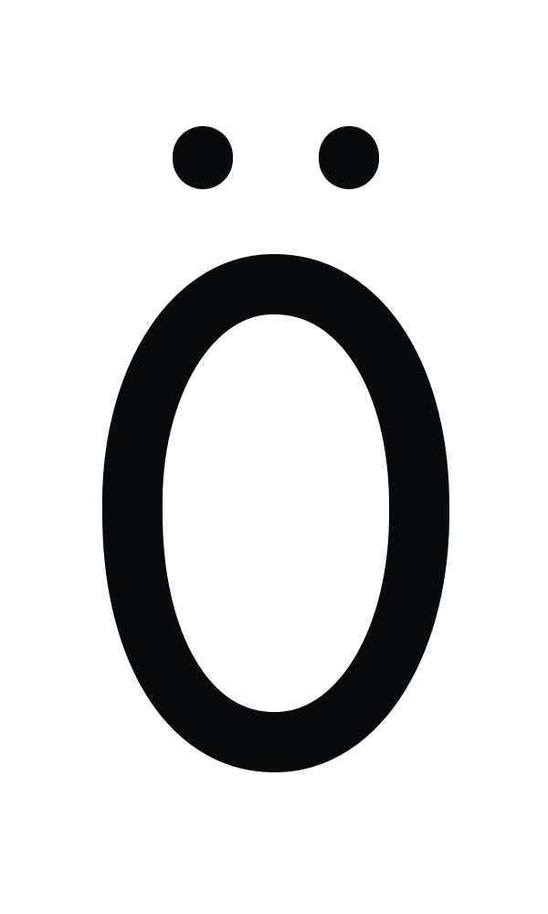
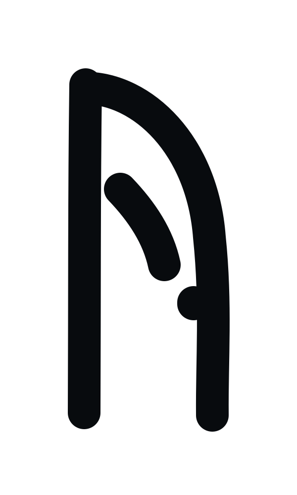
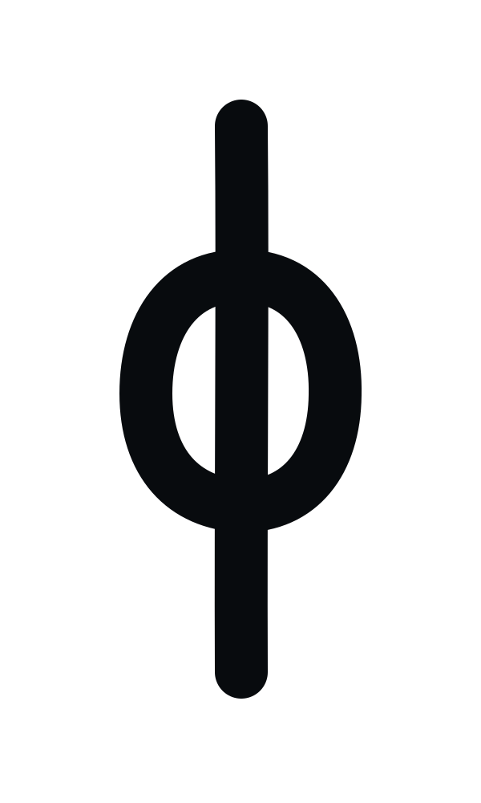
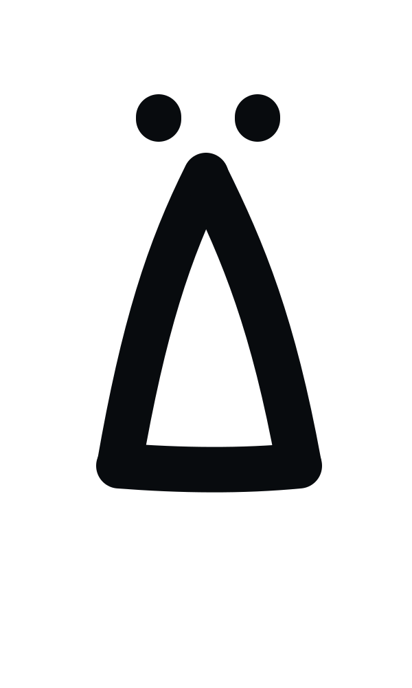

# Player Rune Dictionary

_Status: complete player-facing rune index with approved glyphs (2026-11-21)_

This file lists the **217 registered one-mana Cuspell runes**, each showing its **approved rune artwork**, Latin transliteration and meaning. The G/R/A labels are original design IDs, not additional runes. The separately approved numeric-one sign `@` is listed at the end.

For designer/maintainer detail, frames, historical rationale, and reduction notes, use `docs/CUSPELL_DICTIONARY.md`. Players can use these visible signs as a reading and learning chart. The original PC test font still uses its existing private-use character codes. The separate [meaning-aware offline keyboard](../assets/glyphs/references/idylwild/keyboard_kit/meaning_keyboard.html) and [glyph typing guide](GLYPH_TYPING.md) now convert registered transliterations to these unchanged font codepoints and back; they do not parse spells. [The canonical glyph map](../language/core/glyph_assignments.json) contains the full assignments.

| Rune glyph | Transliteration | Meaning |
| --- | --- | --- |
|  G051 | `About` | States that Information is about a semantic topic. |
|  R017 | `Add` | Adds compatible quantities. |
|  G127 | `Admire` | Evaluative admiration Relation. |
|  G039 | `AfterValue` | Value of a semantic value/attribute at the ending boundary of an event. Registered rune; written cost 1. |
|  A009 | `All` | Universal quantifier over a typed binder. |
|  A014 | `Almost` | Contextual near-satisfaction/near-occurrence operator. The target does not yet hold/occur but is close under a domain-specific criterion; contextual Almost is not magically executable until that criterion is objective. |
|  G043 | `And` | Logical conjunction of propositions or executable conjunction of event specifications where licensed. |
|  G136 | `Angry` | Persistent/contextual anger Property. |
|  R006 | `AnswerFor` | States that Information is an answer to QuestionContent. |
|  R052 | `Area` | Area quantity of a Region. |
|  R005 | `Assert` | Speech EventSpec asserting a proposition; assertion does not make content objectively true. |
|  R086 | `At` | Persistent spatial relation: an entity is at a Location; `End At source` + `Begin At goal` expresses discontinuous relocation without a Move Path. |
|  R084 | `Attack` | Process: an agent attacks a target. |
|  G102 | `Attempt` | EventSpec in which an agent undertakes a real effort aimed at a goal EventSpec; the goal need not succeed. |
|  R015 | `Authority` | Persistent recognized normative standing/competence over a supplied scope; distinct from physical Control, capability, or permission for a particular EventSpec. |
|  G018 | `Awake` | Persistent wakefulness state Property. |
|  R104 | `Ball` | Constructs a spherical Region from center and radius. |
|  R001 | `Before` | Temporal order: first event/time point is earlier than the second. |
|  G035 | `BeforeValue` | Value of a semantic value/attribute at the beginning boundary of an event. Registered rune; written cost 1. |
|  R031 | `Begin` | Begins a persistent state; also returns the beginning TimePoint of an Event or TimeInterval. |
|  A041 | `Believe` | Persistent epistemic state: a mind believes a proposition. |
|  R078 | `Beneficiary` | Marks an entity as beneficiary of an Event/EventSpec; distinct from recipient, transfer, possession, or intended Purpose. |
|  R019 | `Bite` | Process: an agent bites a target; oral biting manner is not identical to generic Attack, Eat, Touch, or Damage. |
|  G100 | `CamouflagedAgainst` | Contextual observer/background-sensitive camouflage state; concrete ColorOf/TextureOf values alone do not define the full relation. |
|  R097 | `Can` | Persistent capability state for carrying out an EventSpec; `Begin Can ...` expresses skill acquisition. |
|  R047 | `Cause` | Causal relation between actual Events, or causative EventSpec where an entity causes an EventSpec/state; an optional third Entity records the instrument. |
|  A052 | `Center` | Returns the center Location of a Region. |
|  A030 | `Change` | EventSpec that sets an attribute/family value to a target. |
|  G107 | `Climb` | Process: an agent climbs a target/entity; climbing manner is not merely upward Move and can include down/across/over traversal. |
|  A070 | `Collect` | Collects values from a typed binder domain that satisfy an optional predicate; the result keeps that value type. |
|  G067 | `CompassionFor` | Compassion Relation toward another entity. |
|  A036 | `Concurrent` | Constructs an EventSpec whose component events occur concurrently. |
|  A058 | `Confidence` | Degree of confidence a mind assigns to a proposition. |
|  R076 | `Contrast` | Contextual discourse contrast/concession relation; unlike plain And, it also marks tension or expectation mismatch between the represented sides. |
|  G089 | `Control` | Persistent control/manipulability relation; concurrent `Begin Touch` + `Begin Control` expresses grabbing/taking hold. |
|  A028 | `Create` | Allocates exactly one fresh Entity identity and binds it into an objective post-creation profile; an optional continuation may immediately use that fresh result in the same command. Distinct from reactivating an existing identity with `Begin Exist`. |
|  G013 | `Count` | Returns the nonnegative integer count of members in a collection. |
|  G130 | `Counterfactual` | Contextual proposition: in a relevant contrary-to-actual alternative history where the antecedent holds, the consequent holds. |
|  G028 | `Damage` | Ordered physical-damage/injury degree Attribute. |
|  A035 | `Density` | Scalar density attribute of an entity; returns a Density quantity. |
|  G122 | `Directive` | Constructs semantic CommandContent from an EventSpec without executing it. |
|  G086 | `Distance` | Physical/spatial separation between SpatialValues such as Entities, Locations, and Regions; returns Length. |
|  R038 | `DistributionOf` | Constructs a spatial Distribution of a resource over a host. |
|  G053 | `Divide` | Divides quantities and combines their dimensions. |
|  R103 | `Dodge` | Contextual evasive Process intended to avoid a threat; it need not prevent the threatening event itself. |
|  A060 | `During` | Temporal containment/holding of events, points, EventSpecs, or propositions over an explicit interval/reference. |
|  A029 | `Each` | Applies an EventSpec to each member of a collection. |
|  G019 | `Eat` | Process: an agent consumes an entity as food. |
|  G025 | `Edge` | Returns edge Region(s) of an entity/Region. |
|  R083 | `End` | Ends a persistent state; also returns an Event's ending TimePoint. |
|  R110 | `EngagedTo` | Persistent betrothal/engagement Relation. |
|  A046 | `Equal` | States exact equality between two values of compatible type. |
|  R023 | `Evaluate` | Produces an ordered evaluation of a target. Two-argument form names the evaluator; one-argument form uses the discourse evaluator/context. |
|  G064 | `EvidenceFor` | States that Information is evidence supporting a proposition. |
|  G029 | `Exist` | Existence state over entities and semantic values such as Sign tokens; `Cause A Begin Exist S` expresses agentive creation of S. |
|  R028 | `Expect` | Relation: expect; roles mind, content; produces StateProposition. |
|  G060 | `Explains` | States that an Explanation explains a proposition; a contextual Proposition+Proposition frame covers ordinary discourse explanation (`target because reason`). |
|  G088 | `Extent` | General extent family: occupied Region, contextual holistic extent/size, axis-indexed projected Length, or temporal extent of an Event/TimeInterval. |
|  G109 | `Fall` | Process: an entity undergoes non-agentive, context/gravity-governed falling motion. |
|  G137 | `Fear` | Fear Relation toward an Entity/Event/Proposition/other semantic target. |
|  A062 | `Female` | Positive biological-sex classification Property; not defined as Not Male. Exact membership belongs to world ontology. |
|  A043 | `Filter` | Filters a collection by a typed binder/predicate. |
|  G024 | `Find` | Bounded factive information-acquisition Process: gives a mind the truthful yes/no or open-query answer within an explicit information-access scope. The scope must be part of the query; blocked/incomplete access is failure, not an empty answer. |
|  R024 | `First` | Selects the first member of an ordered Sequence; with an EventSpec it contextually denotes the next/first matching occurrence. |
|  R059 | `Forgive` | Process: relinquish blame/resentment toward an offender for an offense without necessarily denying responsibility or erasing memory/other emotions. |
|  A026 | `Form` | Geometric/form profile of an entity. |
|  R053 | `FriendOf` | Ordinary friendship Relation. |
|  A037 | `Gas` | Matter-phase value/property: gas. |
|  G131 | `GratefulTo` | Gratitude Relation toward a benefactor. |
|  A013 | `GrieveFor` | Grief Relation concerning a person/event/state. |
|  G016 | `Group` | Kind: a group entity. |
|  A055 | `Gustation` | Sense channel: taste/gustation. |
|  G129 | `Happen` | States that an EventSpec actually occurs, optionally in an interval. |
|  G125 | `Happy` | Persistent/contextual happiness Property. |
|  R021 | `Hard` | Contextual material/structural hardness Property. |
|  G142 | `Hate` | Persistent strong aversive/hostile Relation toward a target. |
|  A016 | `Health` | Ordered overall biological functional-condition Attribute; distinct from Damage and Ill. |
|  G062 | `Have` | Persistent possession/holding relation. |
|  R058 | `Hearing` | Sense channel: hearing. |
|  A051 | `Heat` | Scalar heat attribute of an entity. |
|  R088 | `Here` | Current contextual location. |
|  A001 | `High` | Contextual above-standard predicate over ordered EvaluationValue, Quantity, or Ratio values; with an AttributeDescriptor it forms a first-class threshold Property. |
|  G044 | `Hunger` | Ordered hunger-degree Attribute. |
|  G036 | `If` | Conditional: if the condition holds, the consequent proposition/event follows in the represented structure. |
|  A002 | `Ill` | Persistent pathological/illness-state Property; distinct from Damage, Pain, Low Health, and Not Life. |
|  A008 | `In` | Persistent spatial relation: an entity is in a Region. |
|  R060 | `Infer` | EventSpec in which a mind infers a proposition from Information. |
|  G084 | `Intend` | States an agent's intention to carry out an EventSpec. |
|  R071 | `Interval` | Constructs a TimeInterval from start and end TimePoints. |
|  R112 | `IntervalFor` | Constructs a TimeInterval from a start TimePoint and duration. |
|  G071 | `JealousOf` | Jealous-attitude Relation. |
|  G070 | `Joined` | Persistent structural relation: two entities are joined. |
|  G113 | `Jump` | Contextual launch/airborne locomotion Process; a goal Location may be supplied. Generic Move does not encode the jumping manner. |
|  A039 | `Know` | Persistent epistemic state: a mind knows a proposition. |
|  G046 | `Last` | Selects the last member of an ordered Sequence. |
|  R098 | `Length` | Length attribute of an entity/path. |
|  A024 | `Life` | State property: alive/living. |
|  A015 | `Light` | Scalar light attribute of an entity. |
|  R095 | `Like` | States that an experiencer likes a target. |
|  G117 | `Limp` | Locomotion Process with an asymmetric/impaired gait; does not by itself assert a particular Damage level or cause. |
|  A032 | `Liquid` | Matter-phase value/property: liquid. |
|  A021 | `Locked` | Persistent locked/sealed-by-lock state Property. |
|  G074 | `Loudness` | Ordered sound-loudness Attribute; objective measurement belongs to the world package. |
|  G139 | `Love` | Persistent affectionate/loving Relation toward a target. |
|  A007 | `Low` | Contextual below-standard predicate; with an AttributeDescriptor it forms a first-class threshold Property such as LowHunger. It is not equivalent to Not High. |
|  G007 | `Magic` | Magical-state Property for Entities; also classifies EventSpecs/Events by magical-execution provenance so generic interceptors can match attempted or realized magic. |
|  A064 | `Male` | Positive biological-sex classification Property; not defined as Not Female. Exact membership belongs to world ontology. |
|  A061 | `Mass` | Scalar mass attribute of an entity. |
|  A004 | `Matter` | Kind: matter/material substance. |
|  R111 | `MaxBy` | Tie-preserving maximum selector over a collection using a bound ordered key expression. |
|  G049 | `Meaning` | Relates a Sign to its semantic Information/propositional meaning. |
|  R069 | `Member` | States that an entity is a member of a collection. |
|  R041 | `MinBy` | Tie-preserving minimum selector over a collection using a bound ordered key expression. |
|  R033 | `More` | States that the first ordered value is greater than the second. |
|  A075 | `Most` | Contextual majority/most quantifier over a typed binder. |
|  G001 | `Move` | EventSpec for moving an entity; magical execution must constrain goal or path. |
|  R012 | `Multiply` | Multiplies quantities and combines their dimensions. |
|  A027 | `Name` | Relates a Sign/name to a referent in a naming context. To select a unique referent, use typed `Collect` + `Unique`. |
|  R089 | `Not` | Logical negation of a proposition. |
|  G075 | `Now` | Current contextual time point. |
|  R042 | `Obligated` | Persistent deontic/social responsibility for an EventSpec; an optional third value identifies its social/institutional/interpersonal context. |
|  R054 | `Offset` | Constructs a Location by moving a distance from an origin in a Direction. |
|  G116 | `Olfaction` | Sense channel: smell/olfaction. |
|  R007 | `Open` | Contextual persistent open-state Property relative to an object's closure/design. |
|  A012 | `Opposite` | Numeric opposite/negation of a quantity; also participates in licensed reversible lexical compounds. |
|  A031 | `Or` | Logical disjunction of propositions. |
|  G066 | `Overlap` | General typed overlap relation; Region/Region overlap means nontrivial shared interior extent and composes strict outside. |
|  R085 | `Own` | Ownership/property-right Relation; exact legal rules belong to world ontology. |
|  G056 | `Pain` | Ordered experienced pain/nociceptive-suffering Attribute; distinct from physical Damage. |
|  R064 | `ParentOf` | Parent-child Relation. |
|  G015 | `Part` | States that one entity is a part of another. |
|  R037 | `Partition` | Contextually partitions a collection into fixed-size subcollections. |
|  G032 | `Path` | General ordered route/path Kind. |
|  R040 | `Permitted` | Permission relation: agent+EventSpec states performer permission; EventSpec+Entity states permission/consent from that source. A particular permission does not itself assert broad Authority. |
|  A018 | `Persist` | Actively maintains a state through an interval. |
|  A011 | `Phase` | Matter phase attribute of an entity. |
|  R026 | `Plan` | States that an agent has an EventSpec as a plan. |
|  A010 | `Plasma` | Matter-phase value/property: plasma. |
|  R101 | `Power` | Raises a quantity to a dimensionless exponent; dimensionful bases require a statically known valid exponent. |
|  A074 | `Pressure` | Absolute scalar mechanical-pressure Attribute for an Entity/material/system or a Location; its Quantity dimension is derived from Mass/Length/Time. |
|  A065 | `Preserve` | Constrains a selected value to remain equal across an event boundary. |
|  G041 | `Prevent` | Prevents a specified future EventSpec over an interval; bound form can intercept any attempted EventSpec matching a predicate, optionally limited to a Region, before commit. |
|  R034 | `Purpose` | Persistent intended goal/function relation for a semantic subject, including artifact designed function; temporary Use does not establish it. |
|  G148 | `Question` | Constructs semantic QuestionContent from a proposition or typed open-question binder. |
|  A047 | `Random` | Selects one member from a collection. |
|  A073 | `Rate` | General per-time rate: Quantity-over-Time for a Quantity, or occurrence frequency for an EventSpec. |
|  R102 | `Ratio` | Constructs a ratio from dimensionless numeric components; distinct from numeric division. |
|  G097 | `Reflexive` | States that an EventSpec occurs as an involuntary/reflex response; absence of conscious intention alone is not equivalent. |
|  A068 | `Region` | General spatial Region Kind. |
|  G111 | `Remember` | Memory/retention Relation over semantic content. |
|  R027 | `RemorseFor` | Remorse Relation concerning an action/event/consequence. |
|  G149 | `Repeat` | Repeats an EventSpec a specified number of times, optionally with a period. |
|  A033 | `Represent` | Persistent channel-specific representation: an Entity presents/depicts semantic content through a named SenseChannel. It does not make the represented content real and is distinct from Meaning and Sense. |
|  A071 | `Reputation` | Ordered social-standing Attribute, optionally relative to an explicit community/evaluator. |
|  R046 | `Requires` | States that an outcome/event has a prerequisite proposition. |
|  G123 | `Respect` | Positive-regard Relation acknowledging worth/status/character. |
|  R091 | `ResponsibleFor` | Responsibility-attribution Relation; causal/legal/moral grounds remain separately expressible. |
|  G006 | `Root` | Takes a quantity root; dimensionful inputs require a statically known degree that leaves integral dimension exponents. |
|  G105 | `Rotate` | Rigidly rotates an Entity around an explicit pivot + oriented axis by a signed number of full turns; distinct from Move and Form change. |
|  G121 | `Rule` | General rule/instruction Kind. |
|  G133 | `Sad` | Persistent/contextual sadness Property. |
|  R011 | `Say` | Speech EventSpec carrying a proposition, Information, or quoted Sign. |
|  A025 | `Self` | Current discourse self/speaker/caster reference. |
|  A042 | `Sense` | Generic sensory-acquisition EventSpec with an explicit SenseChannel; it does not by itself mean the Sign/stimulus was understood. |
|  A057 | `Sequence` | Constructs an ordered Sequence value, or an EventSpec that executes event specifications in order. |
|  R051 | `ShameAbout` | Shame Relation concerning an action/property/event/social fact. |
|  A059 | `ShapeLike` | States that an entity's form resembles a Kind/template without asserting Kind identity. |
|  G009 | `Sharp` | Contextual edge/point sharpness Property. |
|  R014 | `Sides` | Returns side Region(s) of an entity, optionally relative to a frame. |
|  G119 | `Sign` | General Sign Kind used by the information/language system. |
|  A066 | `Simultaneous` | States that two events/time points are simultaneous. |
|  G012 | `Sleep` | Persistent contextual sleep-state Property. |
|  A005 | `Solid` | Matter-phase value/property: solid. |
|  A034 | `Some` | Existential quantifier over a typed binder. |
|  R066 | `SpouseOf` | Persistent marriage/spousal Relation. |
|  R100 | `Stab` | Directed puncturing/thrust Process against a target, optionally with an instrument; not equivalent to generic Attack, Damage, Touch, or Use. |
|  R050 | `SufficientFor` | States that a condition is sufficient for an outcome/event. |
|  G037 | `Surface` | Returns the surface Region of an entity. |
|  G069 | `TextureOf` | TextureProfile Attribute of an Entity. |
|  G096 | `That` | Contextual previously/situationally salient entity reference. |
|  G093 | `ThatEvent` | Contextual other/salient event reference. |
|  R009 | `There` | Contextual non-here location. |
|  R074 | `They` | Contextual plural/entity-collection reference. |
|  R094 | `Thing` | General thing/entity Kind. |
|  G068 | `This` | Current salient singular entity reference. |
|  G021 | `ThisEvent` | Current salient event reference. |
|  A020 | `ThisExplanation` | Current salient Explanation value. |
|  R004 | `ThisInformation` | Current salient Information value. |
|  R043 | `ThisInterval` | Current salient time interval. |
|  R036 | `ThisMethod` | Current salient Method value. |
|  R057 | `ThisPath` | Current salient path. |
|  A072 | `ThisRegion` | Current salient region. |
|  R008 | `Through` | States that a Path passes through a Region, or constrains an event to occur through a Region. |
|  A038 | `TimeFlow` | Persistent local temporal-progression relation: an Entity or Region progresses at an explicit nonnegative dimensionless rate relative to an explicit spatial/worldline reference. `@` is equal flow; `Zero` is stopped flow. |
|  R073 | `TotalAmount` | Returns total quantity represented by a Distribution, optionally within a Region. |
|  G058 | `Touch` | Persistent contact-state relation between two entities. |
|  R025 | `TouchChannel` | Sense channel: tactile touch. |
|  R067 | `Toward` | Constructs a Direction toward a reference. |
|  R068 | `Transfer` | EventSpec moving a resource/value from source to destination, optionally with an amount and destination Distribution profile. |
|  G146 | `Trigger` | Creates an EventSpec that fires an action when a condition becomes true within a lifetime/scope. |
|  G003 | `True` | Boolean/propositional truth literal. |
|  G143 | `Trust` | Interpersonal confidence/reliance Relation. |
|  R081 | `Tube` | Constructs a tubular Region around a Path with a radius. |
|  R035 | `UnavailableValueOf` | States that a particular attribute value exists but is unavailable/inaccessible. |
|  G077 | `Understand` | Comprehension Relation over semantic content. |
|  G038 | `Unique` | Reduces a collection only when it has exactly one member. |
|  R061 | `Unit` | General measurement-unit Kind/root. Specific typed units are historical Old Names such as `«LengthUnit»` and `«DurationUnit»`. |
|  A067 | `UnknownValueOf` | States that a particular attribute value is unknown. |
|  G103 | `Use` | EventSpec in which an agent uses an instrument to pursue a goal EventSpec. |
|  A050 | `Vision` | Sense channel: vision. |
|  A019 | `Volume` | Scalar volume attribute of an entity. |
|  G081 | `Want` | States that a mind desires an event or proposition. |
|  G022 | `When` | Schedules/locates an EventSpec at a time point or interval. |
|  A003 | `Whole` | Persistent structural integrity/completeness state; `End Whole X` expresses loss of wholeness. |
|  A053 | `Worship` | Ordinary intentional/religious worship Process. Worship does not itself entail that the object is objectively divine. |
|  R056 | `You` | Current addressee reference. |
|  A017 | `Zero` | Exact dimensionless numeric zero. |

## Numeric-one sign

The `@` sign means numeric one, separate from the 217 registered core runes and from the thirteen punctuation/grammar signs.

| Sign glyph | Transliteration | Meaning |
| --- | --- | --- |
|  R039 | `@` | Numeric one. |
